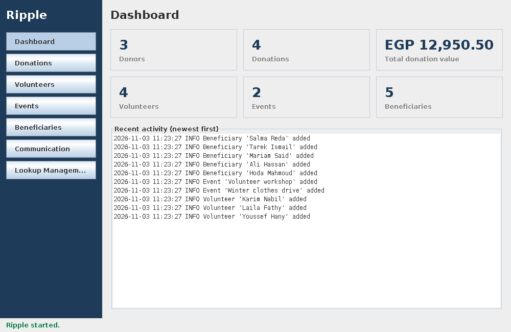

# Ripple — NGO Management System

Ripple is a desktop application that helps a non-profit organization manage donations, volunteers, events, beneficiaries and communication. It is the Phase 1 deliverable of the CSE336 *Software Design Patterns* major task, built to show **MVC** and five design patterns working inside real features: **Strategy, Observer, Decorator, Factory Method and Singleton**.

> **Status:** Phase 1 is complete (all 6 sections of [PHASE1.md](PHASE1.md)): database, lookup tables, Singleton, Factory Method, donations with Observer, receipts with Decorator, the Volunteers, Events and Beneficiaries screens, the Communication screen with Strategy (simulated Email / SMS / Social media and automatic donor thank-yous), and the Dashboard.



**Stack:** Java 21 · Swing with [FlatLaf](https://www.formdev.com/flatlaf/) · SQLite · Maven · JUnit 5

---

## Run in 2 minutes

You need **JDK 21+** and **Maven 3.9+** on your `PATH` (check with `java -version` and `mvn -version`). Same on Windows and Linux.

```bash
mvn compile exec:java
```

Run the tests:

```bash
mvn test
```

Build one runnable jar and start it. It contains Ripple and the SQLite driver, so it only needs Java 21 (no Maven) on the machine that runs it:

```bash
mvn package
java -jar target/ripple.jar
```

The app creates `data/ripple.db` (the database) and `logs/ripple.log` (the activity log) in the folder you start it from. Delete `data/ripple.db` to start again with an empty database.

### Configuration

Ripple has no secrets. The only setting is where the database file is stored:

| Environment variable | Default | Meaning |
|---|---|---|
| `RIPPLE_DB_PATH` | `data/ripple.db` | Path of the SQLite database file |

See [.env.example](.env.example).

---

## The control panel

The main window (`MainFrame`) has a sidebar with one button per screen and a status bar at the bottom that shows a green message when an action worked and a red one when it did not.

| Screen | What you can do |
|---|---|
| Dashboard | See totals (donors, donations and their total value, volunteers, events, beneficiaries) and the recent activity from the log |
| Donations | Two tabs. *Donors*: add, edit and delete donors (a donor with donations cannot be deleted). *Donations*: record Cash / Online / In-kind / Cheque donations, view each donation's receipt, switch the automatic donor thank-you on or off. This is the complete module; see its [CRUD matrix](docs/crud-matrix.md). |
| Volunteers | Add, edit and delete volunteers; assign a volunteer to an event |
| Events | Add, edit and delete events; register attendees; see an event's attendees and volunteers |
| Beneficiaries | Add, edit and delete beneficiaries |
| Communication | Send a message to a group (donors, volunteers, beneficiaries or an event's attendees) by Email, SMS or Social media (donors with a handle), and read the message log. Sending is **simulated**: nothing is really sent |
| Lookup Management | Add, edit and delete Donation Types and Event Categories |

---

## Where to find each grading item

| Grading item | Marks | See it in the app | In the code | Test |
|---|:-:|---|---|---|
| Class diagram | 2 | — | [docs/class-diagram.md](docs/class-diagram.md) | `DiagramConsistencyTest` |
| MVC structure | 2 | Every screen | `view` → `controller` → `service` / `repository` / `model` ([architecture](docs/architecture.md)) | `ArchitectureRulesTest` |
| User control panel | 1 | The main window | `view/MainFrame.java`, `view/StatusBar.java` | — |
| Strategy | 1 | Communication screen: send by Email, then by SMS | `communication/` (`CommunicationService.setStrategy`) | `CommunicationServiceTest` |
| Observer | 1 | Donations screen: record a donation, then untick "Notify donors". Events screen: change an event's date and its attendees are messaged | `observer/`, `service/DonationService.java`, `service/EventService.java` | `DonationServiceTest`, `DonorNotificationObserverTest`, `EventServiceTest`, `AttendeeNotificationObserverTest` |
| Decorator | 1 | Donations screen: *View receipt* | `receipt/`, `observer/ReceiptObserver.java` | `ReceiptDecoratorTest`, `ReceiptObserverTest` |
| Factory Method | 0.5 | Donations screen: record a donation of each method (Cheque was added as a new creator) | `factory/DonationFactory.java` (creator) + 4 concrete creators | `DonationFactoryTest` |
| Singleton | 0.5 | Dashboard "Recent activity" and `logs/ripple.log` | `logging/ApplicationLogger.java` | `ApplicationLoggerTest` |
| Lookup tables | 0.5 | Lookup Management screen; CRUD matrix for the Donations module in [docs/crud-matrix.md](docs/crud-matrix.md) | `service/LookupService.java` | `LookupServiceTest` |
| Extra client requirements | 0.5 | See the next table | — | — |

---

## Client requirements (our own assumptions)

We had no real client, so these requirements are **our own assumptions**.

| # | What we assumed the client wants | Where to see it |
|:-:|---|---|
| CR1 | No duplicate or empty names in lookup lists ("Zakat" and "zakat " count as the same) | Lookup Management: add "zakat" while "Zakat" exists → red message. `LookupServiceTest` |
| CR2 | A lookup value that is in use cannot be deleted, and the app says how many records use it | Lookup Management: delete "Zakat" after recording a Zakat donation → red message. `LookupServiceTest` |
| CR3 | Every donation gets the date and time automatically, plus a receipt number like `RCP-2026-0007` | Donations table (receipt no., date). `DonationFactoryTest`, `DonationTest` |
| CR4 | Only tax-deductible donation types get tax information on their receipt | *View receipt* on a Zakat donation vs. a Food Supplies donation. `ReceiptObserverTest` |
| CR5 | Each donor picks Email, SMS or Social and automatically gets a thank-you that way; staff can turn this off | Donor form, "Notify donors on new donation" checkbox, Communication message log. `DonorNotificationObserverTest` |
| CR6 | Every action shows a clear success or error message | The status bar at the bottom of every screen. Every controller returns a `Result` |

---

## Documentation

| Document | What it covers |
|---|---|
| [PHASE1.md](PHASE1.md) | What was built, team rules, requirements (incl. client requirements CR1–CR6), and the 6 section checklists |
| [docs/class-diagram.md](docs/class-diagram.md) | Complete UML class diagram, and one diagram per design pattern with a presentation note (problem, solution, why not `if/else`) |
| [docs/architecture.md](docs/architecture.md) | MVC layers, packages, object wiring, sequence diagrams, database schema |

---

## Project structure

```
pom.xml                          Maven build (also builds the runnable jar)
PHASE1.md                        Work plan and requirements
docs/                            Class diagram, architecture, CRUD matrix, images
src/main/java/com/ripple/
  app/            Main — start-up and object wiring
  model/          Domain entities
  factory/        Factory Method pattern
  observer/       Observer pattern
  receipt/        Decorator pattern
  communication/  Strategy pattern
  logging/        Singleton pattern
  repository/     SQL / persistence
  service/        Business rules
  controller/     MVC controllers
  view/           MVC views (Swing) — MainFrame is the control panel
src/test/java/com/ripple/         Unit tests, incl. DiagramConsistencyTest and ArchitectureRulesTest
```
