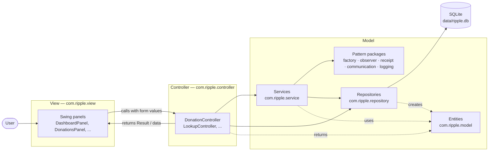
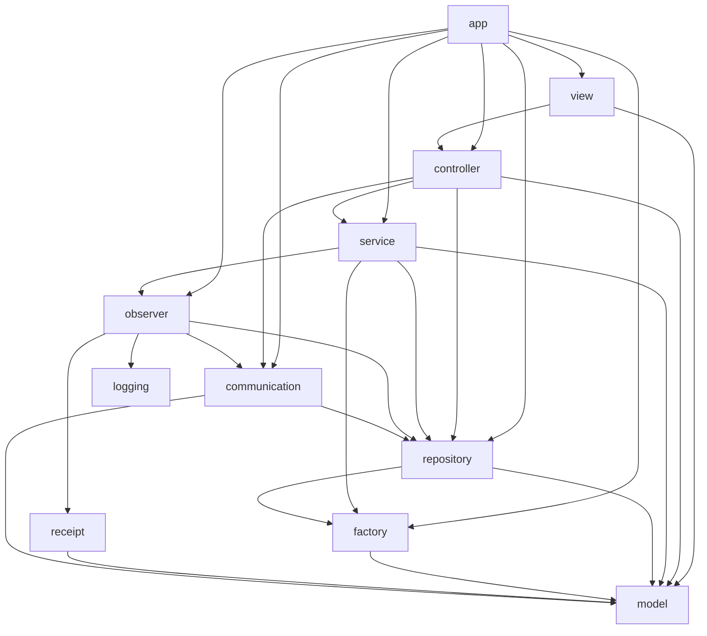
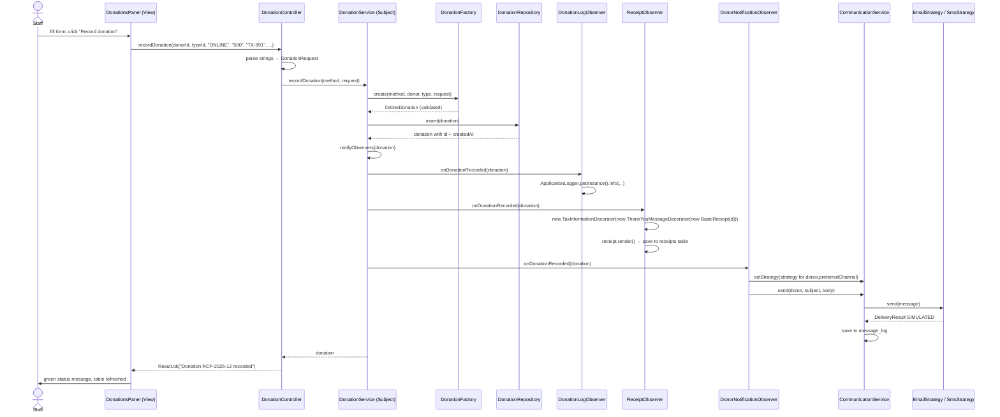
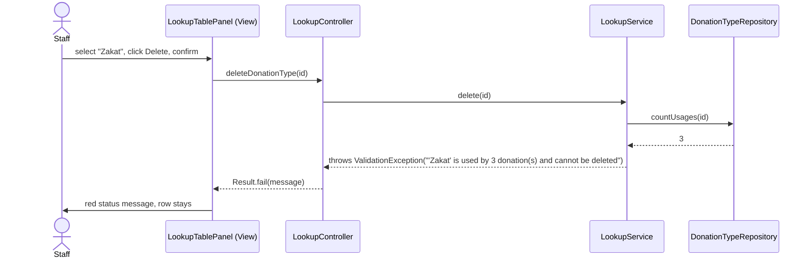
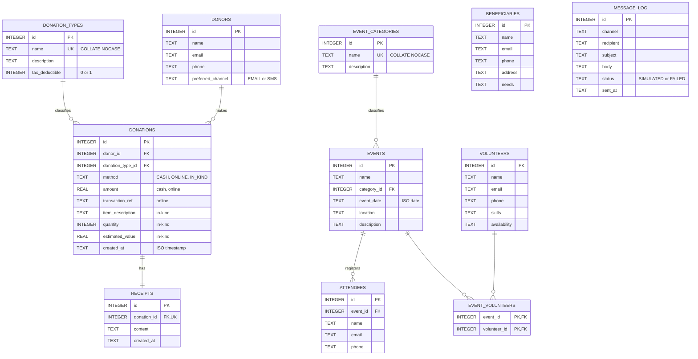

# Ripple — Architecture

> How Ripple is organised, why, and how one user action travels through the code.
> Read this before writing code for any section. If your change makes something here untrue, update it in the same change.

Related: [class-diagram.md](class-diagram.md) (classes and pattern diagrams) · [PHASE1.md](../PHASE1.md) (requirements and who builds what)

---

## 1. Technology

| Choice | Why |
|---|---|
| **Java 21** | Same language as the course labs, so the pattern code looks like the lecture examples. |
| **Swing** (built into the JDK) | Desktop UI with no extra install. Each screen is a `JPanel`, which maps cleanly to an MVC *View*. |
| **SQLite** via `sqlite-jdbc` | A single file database (`data/ripple.db`). No server to install, works on Windows and Linux. |
| **Plain JDBC** (no ORM) | Every SQL statement is visible in one layer, which makes the Model easy to explain. |
| **Maven** | Standard build: `mvn test`, `mvn compile exec:java`, `mvn package`. |
| **JUnit 5** | Tests for business rules and for each pattern. |

Only two libraries are used: `sqlite-jdbc` (the database driver) and `junit-jupiter` (tests only).

---

## 2. MVC with a thin service layer



### Responsibilities and rules

| Layer | Package | Does | Never does |
|---|---|---|---|
| **View** | `view` | Builds widgets, reads form fields, calls one controller method, shows the returned data or `Result` message. | SQL, validation rules, creating domain objects with business meaning, talking to repositories. |
| **Controller** | `controller` | Converts UI strings into typed values, calls the right service or repository, catches `ValidationException` and returns a `Result`. | Build widgets, write SQL. |
| **Service** (Model) | `service` | Business rules: lookup uniqueness and in-use checks, donor validation, recording donations and notifying observers. | Know about Swing. |
| **Pattern packages** (Model) | `factory`, `observer`, `receipt`, `communication`, `logging` | The five design patterns. | Know about Swing. |
| **Repository** (Model) | `repository` | The **only** place with SQL. Turns rows into entities and back. | Business rules. |
| **Entity** (Model) | `model` | Domain data and small behaviour (`Donation.getValue()`, `getReceiptNumber()`). | Know about the database or the UI. |

**Why a service layer?** Rules like "no duplicate lookup names" must not live in a button handler (view) and should not be repeated in every controller. Services are added **only** where there are real rules: `LookupService`, `DonationService`. Simple CRUD screens (volunteers, events, beneficiaries) go controller → repository directly, with shared input checks in `InputValidator`.

**How separation is checked:** no class in `com.ripple.view` imports `java.sql` or `com.ripple.repository`. Section 6 checks it with this grep, which must print nothing:

```bash
grep -rlE "import (java\.sql|com\.ripple\.repository)" src/main/java/com/ripple/view
```

---

## 3. Packages



| Package | Purpose |
|---|---|
| `com.ripple.app` | `Main` — the **composition root**: builds every object once and wires them together. |
| `com.ripple.model` | Entities (`Donor`, `Donation` hierarchy, `Volunteer`, `Event`, ...), lookup entities, enums, the `Contactable` interface. |
| `com.ripple.factory` | **Factory**: `DonationFactory`, `DonationRequest`. |
| `com.ripple.observer` | **Observer**: `DonationSubject`, `DonationObserver` and three concrete observers. |
| `com.ripple.receipt` | **Decorator**: `Receipt`, `BasicReceipt`, `ReceiptDecorator` and two decorators. |
| `com.ripple.communication` | **Strategy**: `CommunicationStrategy`, `EmailStrategy`, `SmsStrategy`, context `CommunicationService`. |
| `com.ripple.logging` | **Singleton**: `ApplicationLogger`. |
| `com.ripple.repository` | `Database` and one repository per table group. |
| `com.ripple.service` | `LookupService`, `DonationService`, `InputValidator`, `ValidationException`. |
| `com.ripple.controller` | One controller per screen, plus `Result` and `DashboardSummary`. |
| `com.ripple.view` | `MainFrame` (the control panel), one panel per screen, `StatusBar`, `Refreshable`. |

---

## 4. Composition root (object wiring)

`Main` creates everything once, in this order, and passes objects through constructors. Apart from the logger Singleton there is **no global state**, so every class can be tested with its own inputs.

1. `Database` (reads `RIPPLE_DB_PATH`, default `data/ripple.db`) → `initialize()` creates tables and seed data.
2. `DonationFactory`, then repositories (the donation repository gets the factory so it can rebuild donations from rows).
3. Strategies: `Map.of(EMAIL, new EmailStrategy(), SMS, new SmsStrategy())`.
4. Services: `LookupService` ×2, `DonationService`.
5. Observers attached to `DonationService`: `DonationLogObserver`, `ReceiptObserver`, `DonorNotificationObserver`.
6. Controllers.
7. On the Swing event thread: `MainFrame`, then each screen plugged in with `frame.addScreen(MainFrame.LOOKUPS, new LookupPanel(lookupController, frame.getStatusBar()))`. Until a screen is plugged in, its sidebar button shows a placeholder naming the section that builds it.

`Main.java` already contains a `// Section N:` comment at each of these places; add your lines there.

---

## 5. Request flows

### 5.1 Record a donation (uses Factory, Observer, Decorator, Strategy, Singleton)



If the factory rejects the input (e.g. online donation without a transaction reference), it throws `ValidationException`; nothing is saved, no observer runs, and the controller returns `Result.fail(message)`.

### 5.2 Delete a lookup value that is in use (CR2)



---

## 6. Data model



**Single-table donations.** The three donation kinds share one `donations` table with nullable method-specific columns. This keeps queries and the "total value" dashboard number simple. `DonationRepository` reads `method` and passes the row to `DonationFactory`, so the **same factory** builds the right subclass when loading from the database.

Foreign keys are switched on (`PRAGMA foreign_keys = ON`) as a safety net under the service-level in-use check. Seed data: donation types *General Fund* (tax), *Zakat* (tax), *Education* (tax), *Food Supplies* (no tax); event categories *Fundraiser*, *Workshop*, *Outreach*.

---

## 7. Key design decisions

| Decision | Alternative considered | Reason |
|---|---|---|
| Only **one** Singleton (`ApplicationLogger`) | Making `Database` a Singleton too | A singleton database would make tests share one DB. Passing `Database` by constructor lets each test use its own temp file. |
| `DonationService` **is** the Subject | A separate `DonationEventPublisher` class | The service is exactly where "a donation was recorded" becomes true; an extra class would only forward calls. |
| Strategies chosen per donor in `DonorNotificationObserver` | Branching on channel inside `CommunicationService` | Branching would undo the Strategy pattern; the context must not know concrete channels. |
| `TaxInformationDecorator` applied conditionally | A `boolean showTax` flag inside `BasicReceipt` | Flags inside the base class are what Decorator replaces; the base receipt never changes. |
| Generic `LookupService<T>` + `LookupRepository<T>` | Copy-pasting code for both lookup tables | Both tables follow the same rules (CR1, CR2); one implementation removes duplication. |
| Simulated communication | Real SMTP/SMS | No credentials in Phase 1 and tests must not use the network. The simulation is labelled honestly. |

---

## 8. Ready for Phase 2 (not implemented)

Phase 2 patterns are **not** built in Phase 1. The design simply avoids blocking them:

- A real email/SMS provider can be wrapped and plugged in as another `CommunicationStrategy`.
- Controllers are the single entry point for user actions, so turning actions into objects later stays local.
- Services expose small, clear methods, so a single simplified entry point over several of them can be added later without changing them.
