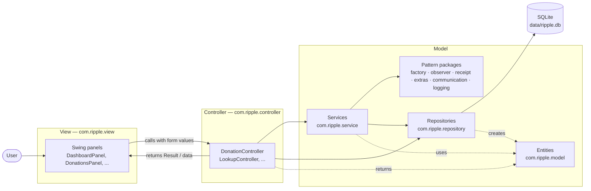
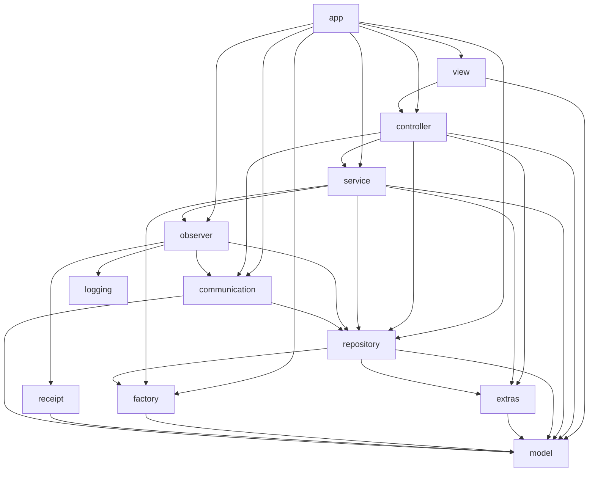
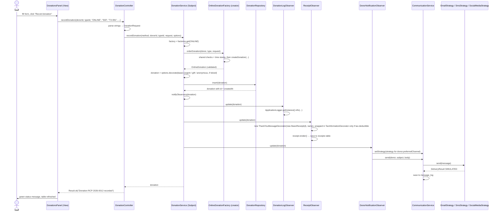
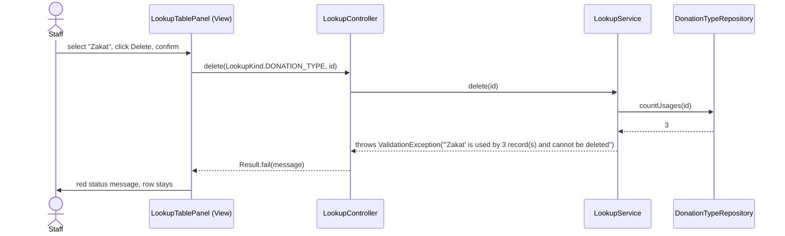
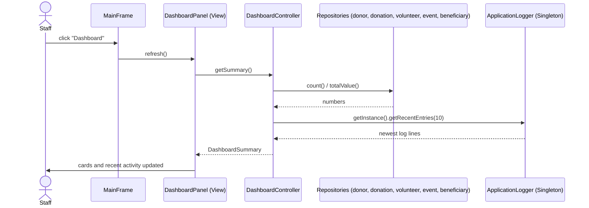
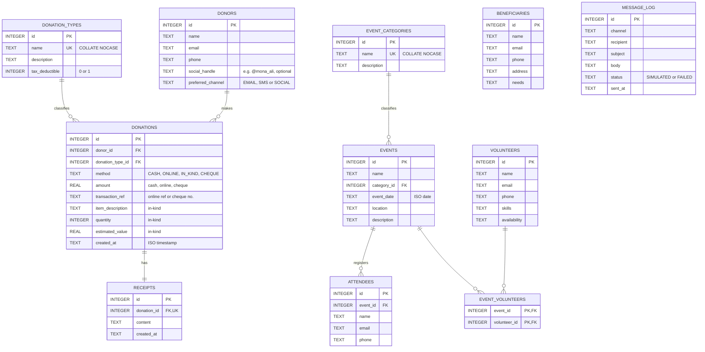

# Ripple — Architecture

> How Ripple is organised, why, and how one user action travels through the code.
> Read this before writing code for any section. If your change makes something here untrue, update it in the same change.

Related: [class-diagram.md](class-diagram.md) (classes and pattern diagrams) · [README](../README.md) (how to run, grading items, client requirements)

---

## 1. Technology

| Choice | Why |
|---|---|
| **Java 21** | Same language as the course labs, so the pattern code looks like the lecture examples. |
| **Swing** (built into the JDK) | Desktop UI with no extra install. Each screen is a `JPanel`, which maps cleanly to an MVC *View*. |
| **FlatLaf** | A modern look for Swing that is the same on Windows and Linux. Used only by `Main` and the `view` package. |
| **SQLite** via `sqlite-jdbc` | A single file database (`data/ripple.db`). No server to install, works on Windows and Linux. |
| **Plain JDBC** (no ORM) | Every SQL statement is visible in one layer, which makes the Model easy to explain. |
| **Maven** | Standard build: `mvn test`, `mvn compile exec:java`, `mvn package`. |
| **JUnit 5** | Tests for business rules and for each pattern. |

Only three libraries are used: `sqlite-jdbc` (the database driver), `flatlaf` (the look of the UI) and `junit-jupiter` (tests only).

---

## 2. MVC with a thin service layer



### Responsibilities and rules

| Layer | Package | Does | Never does |
|---|---|---|---|
| **View** | `view` | Builds widgets, reads form fields, calls one controller method, shows the returned data or `Result` message. | SQL, validation rules, creating domain objects with business meaning, talking to repositories. |
| **Controller** | `controller` | Converts UI strings into typed values, calls the right service or repository, catches `ValidationException` and returns a `Result`. | Build widgets, write SQL. |
| **Service** (Model) | `service` | Business rules: lookup uniqueness and in-use checks, donor validation, recording donations, saving events, and notifying observers. | Know about Swing. |
| **Pattern packages** (Model) | `factory`, `observer`, `receipt`, `extras`, `communication`, `logging` | The five design patterns (Decorator twice: receipts and donation extras). | Know about Swing. |
| **Repository** (Model) | `repository` | The **only** place with SQL. Turns rows into entities and back. | Business rules. |
| **Entity** (Model) | `model` | Domain data and small behaviour (`Donation.getValue()`, `getReceiptNumber()`). | Know about the database or the UI. |

**Why a service layer?** Rules like "no duplicate lookup names" must not live in a button handler (view) and should not be repeated in every controller. Services are added **only** where there are real rules: `LookupService`, `DonationService` and `EventService` (which notifies attendees when an event's date or location changes). Simple CRUD screens (volunteers, beneficiaries) go controller → repository directly, with shared input checks in `InputValidator`. The Events screen saves events through `EventService` and reads attendees and volunteers from the repositories.

**How separation is checked:** no class in `com.ripple.view` imports `java.sql` or `com.ripple.repository`. `ArchitectureRulesTest` checks this on every `mvn test`, and you can also run this grep, which must print nothing:

```bash
grep -rlE "import (java\.sql|com\.ripple\.repository)" src/main/java/com/ripple/view
```

---

## 3. Packages



| Package | Purpose |
|---|---|
| `com.ripple.app` | `Main` — the **composition root**: builds every object once and wires them together. It is described here and not drawn in the class diagram (common-mistakes rule 8: no "system" class). |
| `com.ripple.model` | Entities (the `Person` hierarchy: `Donor`, `Volunteer`, `Attendee`, `Beneficiary`; the `Donation` hierarchy; `Event`, ...), lookup entities, enums, the `Contactable` interface. |
| `com.ripple.factory` | **Factory Method**: abstract creator `DonationFactory`, the four concrete creators (`CashDonationFactory`, `OnlineDonationFactory`, `InKindDonationFactory`, `ChequeDonationFactory`), `DonationRequest`. |
| `com.ripple.observer` | **Observer**: `DonationSubject`, `DonationObserver` and three concrete observers; `EventSubject`, `EventObserver` and `AttendeeNotificationObserver` for event changes. |
| `com.ripple.receipt` | **Decorator**: `Receipt`, `BasicReceipt`, `ReceiptDecorator` and two decorators. |
| `com.ripple.extras` | **Decorator** on the donation itself: `DonationDecorator` and `UrgentDonation`, `GiftDonation`, `AnonymousDonation`; `DonationOptions` applies them. |
| `com.ripple.communication` | **Strategy**: `CommunicationStrategy`, `EmailStrategy`, `SmsStrategy`, `SocialMediaStrategy`, context `CommunicationService`. |
| `com.ripple.logging` | **Singleton**: `ApplicationLogger`. |
| `com.ripple.repository` | `Database` and one repository per table group. |
| `com.ripple.service` | `LookupService`, `DonationService`, `EventService`, `InputValidator`, `ValidationException`. |
| `com.ripple.controller` | One controller per screen, plus `Result` and `DashboardSummary`. |
| `com.ripple.view` | `MainFrame` (the control panel), one panel per screen, `StatusBar`, `Refreshable`. |

---

## 4. Composition root (object wiring)

`Main` creates everything once, in this order, and passes objects through constructors. Apart from the logger Singleton there is **no global state**, so every class can be tested with its own inputs.

1. `Database` (reads `RIPPLE_DB_PATH`, default `data/ripple.db`) → `initialize()` creates tables and seed data.
2. The donation creators, one `DonationFactory` subclass per method, in a `Map<DonationMethod, DonationFactory>` keyed by `getMethod()`; then repositories (the donation repository gets the map so it can rebuild donations from rows).
3. Strategies: `Map.of(EMAIL, new EmailStrategy(), SMS, new SmsStrategy(), SOCIAL, new SocialMediaStrategy())`.
4. Services: `LookupService` ×2, `DonationService`, `EventService`.
5. Observers attached to `DonationService`: `DonationLogObserver`, `ReceiptObserver`, `DonorNotificationObserver`. Attached to `EventService`: `AttendeeNotificationObserver` (Email then SMS, with its own `CommunicationService`).
6. Controllers, including `DashboardController` (it gets the five repositories it counts).
7. On the Swing event thread: `MainFrame`, then each of the seven screens plugged in with `frame.addScreen(MainFrame.LOOKUPS, new LookupPanel(lookupController, frame.getStatusBar()))`.

`Main.java` groups these lines with `// Section N` comments (1 to 6), one per build stage of Phase 1: lookups, donations, receipts, volunteers / events / beneficiaries, communication, and the Dashboard.

---

## 5. Request flows

### 5.1 Record a donation (uses Factory Method, Observer, Decorator, Strategy, Singleton)



If the creator rejects the input (e.g. online donation without a transaction reference), it throws `ValidationException`; nothing is saved, no observer runs, and the controller returns `Result.fail(message)`.

### 5.2 Delete a lookup value that is in use (CR2)



### 5.3 Open the Dashboard (uses Singleton)



`MainFrame` calls `refresh()` every time a `Refreshable` screen is opened, so the Dashboard always shows the current numbers. If the database cannot be read, the controller logs the error and returns zeros with an explanation instead of throwing to the view.

---

## 6. Data model



**Single-table donations.** The four donation kinds share one `donations` table with nullable method-specific columns (a cheque's number is stored in `transaction_ref`). This keeps queries and the "total value" dashboard number simple. `DonationRepository` reads `method` and passes the row to the creator for that method, so the **same creators** build the right subclass when loading from the database.

Foreign keys are switched on (`PRAGMA foreign_keys = ON`) as a safety net under the service-level in-use check. Seed data: donation types *General Fund* (tax), *Zakat* (tax), *Education* (tax), *Food Supplies* (no tax); event categories *Fundraiser*, *Workshop*, *Outreach*.

---

## 7. Key design decisions

| Decision | Alternative considered | Reason |
|---|---|---|
| Only **one** Singleton (`ApplicationLogger`) | Making `Database` a Singleton too | A singleton database would make tests share one DB. Passing `Database` by constructor lets each test use its own temp file. |
| `DonationService` **is** the Subject | A separate `DonationEventPublisher` class | The service is exactly where "a donation was recorded" becomes true; an extra class would only forward calls. |
| Strategies chosen per donor in `DonorNotificationObserver` | Branching on channel inside `CommunicationService` | Branching would undo the Strategy pattern; the context must not know concrete channels. |
| `TaxInformationDecorator` applied conditionally | A `boolean showTax` flag inside `BasicReceipt` | Flags inside the base class are what Decorator replaces; the base receipt never changes. |
| Generic `LookupService<T>` + `LookupRepository<T>` | Copy-pasting code for both lookup tables | Both tables follow the same rules (CR1, CR2); one implementation removes duplication. |
| Simulated communication | Real SMTP/SMS | No credentials in Phase 1 and tests must not use the network. The simulation is labelled honestly. |

---

## 8. Ready for Phase 2 (not implemented)

Phase 2 patterns are **not** built in Phase 1. The design simply avoids blocking them:

- A real email/SMS provider can be wrapped and plugged in as another `CommunicationStrategy`.
- Controllers are the single entry point for user actions, so turning actions into objects later stays local.
- Services expose small, clear methods, so a single simplified entry point over several of them can be added later without changing them.
