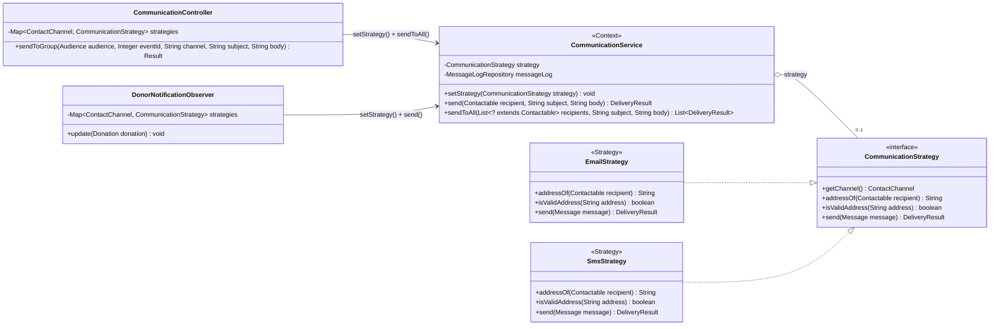
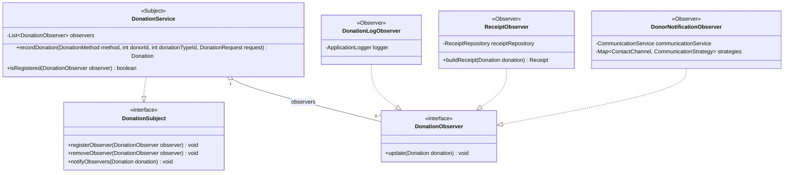
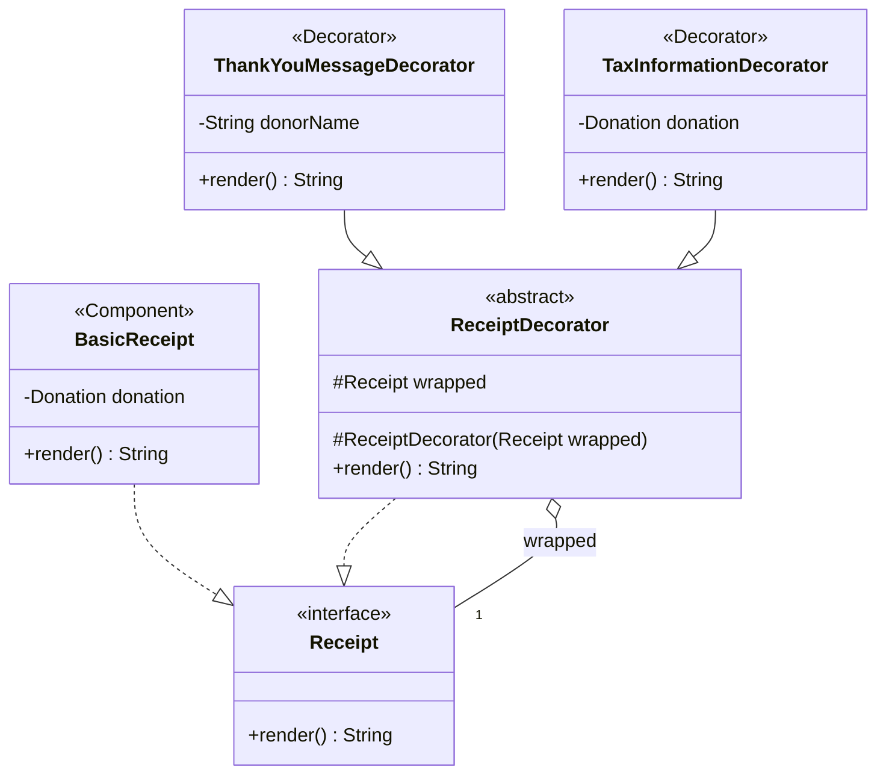
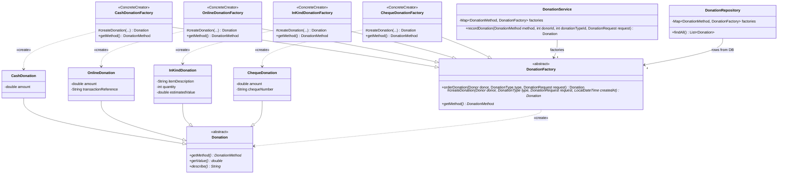
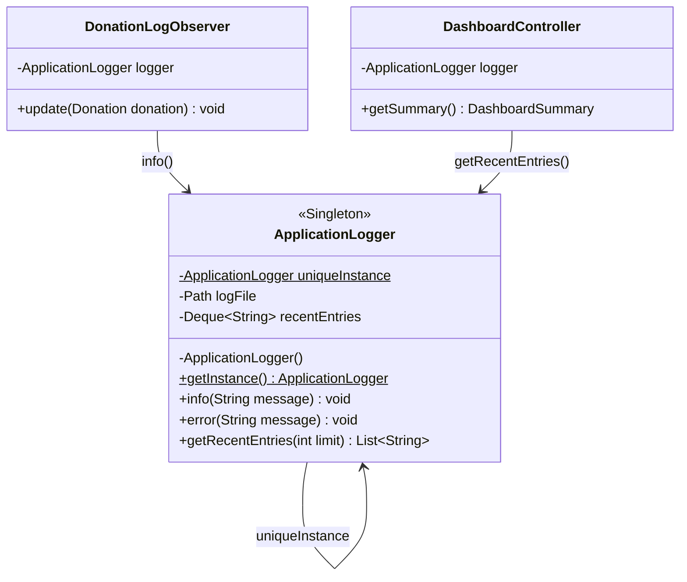
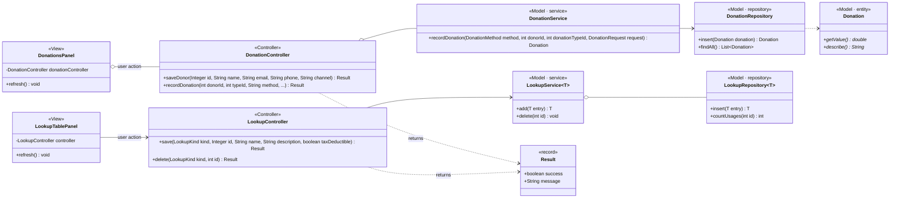

# Ripple — Class Diagram

> The complete UML class diagram of **Ripple**, Phase 1, plus one focused diagram per design pattern (section 5).

**This diagram is the team contract.** Whatever section of [PHASE1.md](../PHASE1.md) you are working on, create your classes **with exactly these names, fields and methods**. If you need to change a class, update this diagram in the same change. `DiagramConsistencyTest` (`src/test/java/com/ripple/DiagramConsistencyTest.java`) fails the build if the classes in the code and in this diagram drift apart.

**Printable picture:** [images/class-diagram.svg](images/class-diagram.svg) (zoomable vector) and [images/class-diagram.png](images/class-diagram.png) show the complete diagram below as one UML picture, grouped and coloured by layer and pattern. They are generated from section 2 with Graphviz; regenerate them whenever section 2 changes.

Related: [architecture.md](architecture.md) (layers, object wiring, sequence diagrams, database) · [PHASE1.md](../PHASE1.md) (who builds what)

---

## 1. How to read this diagram

### Arrows

| Notation (Mermaid) | UML name | Meaning in Ripple | Example |
|---|---|---|---|
| `A --\|> B` (solid line, hollow triangle) | **Generalization** (inheritance) | `A extends B` | `CashDonation --\|> Donation` |
| `A ..\|> B` (dashed line, hollow triangle) | **Realization** | `A implements B` (B is an interface) | `EmailStrategy ..\|> CommunicationStrategy` |
| `A --> B` (solid line, open arrow) | **Association** (the default) | `A` keeps a field of type `B` and calls **5 or fewer** of its methods | `DonationController --> ReceiptRepository` |
| `A o-- B` (hollow diamond at A) | **Aggregation** | `A` keeps a field of type `B`, does not own its life (`B` is created elsewhere and passed in), and calls **more than 5** of its methods; also used where the pattern's own UML in the lab slides has a diamond (Observer's list, Decorator's `wrapped`, Strategy's context) | `LookupService o-- LookupRepository` (7 methods) |
| `A *-- B` (filled diamond at A) | **Composition** | `A` creates and owns `B`; `B` lives and dies with `A` | `MainFrame *-- StatusBar` |
| `A ..> B` (dashed line, open arrow) | **Dependency** | `A` uses `B` only inside a method (parameter, return, local, or `new`) | `CashDonationFactory ..> CashDonation : «create»` |

### Multiplicities

Written at each end of an association: `"1"` exactly one, `"0..1"` optional, `"*"` / `"0..*"` many, `"2"` exactly two.
Example: `Donation "*" --> "1" Donor` — each donation has exactly one donor; a donor can have many donations.

### Member notation

| Symbol | Meaning |
|---|---|
| `+` / `-` / `#` | public / private / protected |
| `name()*` | abstract method |
| `name()$` / `field$` | static method / static field |
| `List~T~` | generic type, i.e. `List<T>` |
| `<<interface>>`, `<<abstract>>`, `<<enumeration>>`, `<<record>>` | kind of type |
| `<<Singleton>>`, `<<Subject>>`, `<<Observer>>`, `<<Strategy>>`, `<<Context>>`, `<<Component>>`, `<<Decorator>>`, `<<ConcreteCreator>>` | the design-pattern role the class plays |

### What is left out on purpose

- **Plain getters and setters** (`getName()`, `setName(...)`) for the attributes shown — they would double the diagram's size and add nothing. Getters with real logic (e.g. `getReceiptNumber()`) **are** shown.
- **Constructors**, except where the constructor is part of the pattern (the Singleton's private constructor, the decorator's protected constructor) and for `EventCategory`, whose constructor is its only own member (no empty classes).
- **`Main`**, the composition root that only creates and wires objects. It is a "system" class, so it is described in [architecture.md §4](architecture.md#4-composition-root-object-wiring) instead of drawn (common-mistakes rule 8).
- **Swing widget fields inside views** (text fields, tables, buttons) and their small private helper methods. Views show only the controllers and status bar they depend on.
- **`toString()` overrides** that only return a display name for combo boxes (`Donor`, `DonationMethod`).
- **Swing and JDK classes** (`JPanel`, `JFrame`, `RuntimeException`). Inheritance from them is stated in the class tables below.

### Checked against the course's "Common Mistakes in Class Diagram"

| # | Rule | How this diagram follows it |
|---|---|---|
| 1 | No empty class | Every class shows at least one member, in the complete diagram and in the pattern views (`EventCategory` shows its constructor). |
| 2 | No stand-alone class | Every class has at least one relationship. |
| 3 | No inheritance cycles | All generalizations point one way (e.g. `CashDonation → Donation`, `ThankYouMessageDecorator → ReceiptDecorator`). |
| 4 | Balance the relationship types | Generalization, realization, association, aggregation, composition and dependency are all used, each for its own meaning (table above). |
| 5 | No single inheritance (a parent with one child) | Every superclass has at least two subclasses (`Donation` 4, `DonationFactory` 4, `LookupEntry` 2, `ReceiptDecorator` 2). The one interface with a single implementer, `DonationSubject`, is the slides' Subject/WeatherData shape (see section 4). |
| 6 | Use interfaces where possible | `Contactable`, `CommunicationStrategy`, `DonationSubject`, `DonationObserver`, `Receipt`, `LookupRepository<T>`, `Refreshable`. |
| 7 | Association by default, aggregation if more than 5 functions are used | Counted method by method in the code; the 8 arrows above 5 are aggregations and are listed in section 4. |
| 8 | No "system" class | `Main` (the composition root) is not drawn. |
| 9 | No print statements in core classes | No class in `src/main/java` writes to `System.out` or `System.err`; output goes to the screen, the message log or `ApplicationLogger`. |
| 10 | Real diagrams are large | 78 classes in 10 packages, all from the code, with one smaller view per pattern in section 5. |

---

## 2. Complete diagram

Packages are drawn as namespaces (`com.ripple.<namespace>`).

```mermaid
classDiagram
direction TB

%% ===================== model =====================
namespace model {
    class Contactable {
        <<interface>>
        +getName() String
        +getEmail() String
        +getPhone() String
    }
    class ContactChannel {
        <<enumeration>>
        EMAIL
        SMS
        +getAddressLabel() String
    }
    class DonationMethod {
        <<enumeration>>
        CASH
        ONLINE
        IN_KIND
        CHEQUE
        +getLabel() String
    }
    class Donor {
        -int id
        -String name
        -String email
        -String phone
        -ContactChannel preferredChannel
    }
    class Donation {
        <<abstract>>
        -int id
        -Donor donor
        -DonationType donationType
        -LocalDateTime createdAt
        +getMethod()* DonationMethod
        +getValue()* double
        +describe()* String
        +getReceiptNumber() String
        +isTaxDeductible() boolean
    }
    class CashDonation {
        -double amount
        +getMethod() DonationMethod
        +getValue() double
        +describe() String
    }
    class OnlineDonation {
        -double amount
        -String transactionReference
        +getMethod() DonationMethod
        +getValue() double
        +describe() String
    }
    class InKindDonation {
        -String itemDescription
        -int quantity
        -double estimatedValue
        +getMethod() DonationMethod
        +getValue() double
        +describe() String
    }
    class ChequeDonation {
        -double amount
        -String chequeNumber
        +getMethod() DonationMethod
        +getValue() double
        +describe() String
    }
    class LookupEntry {
        <<abstract>>
        -int id
        -String name
        -String description
        +toString() String
    }
    class DonationType {
        -boolean taxDeductible
    }
    class EventCategory {
        +EventCategory(int id, String name, String description)
    }
    class Volunteer {
        -int id
        -String name
        -String email
        -String phone
        -String skills
        -String availability
    }
    class Event {
        -int id
        -String name
        -EventCategory category
        -LocalDate eventDate
        -String location
        -String description
    }
    class Attendee {
        -int id
        -int eventId
        -String name
        -String email
        -String phone
    }
    class Beneficiary {
        -int id
        -String name
        -String email
        -String phone
        -String address
        -String needs
    }
}

%% ===================== factory =====================
namespace factory {
    class DonationFactory {
        <<abstract>>
        +orderDonation(Donor donor, DonationType type, DonationRequest request) Donation
        #createDonation(Donor donor, DonationType type, DonationRequest request, LocalDateTime createdAt)* Donation
        +getMethod()* DonationMethod
        #requirePositiveAmount(double amount)$ void
    }
    class CashDonationFactory {
        <<ConcreteCreator>>
        #createDonation(Donor donor, DonationType type, DonationRequest request, LocalDateTime createdAt) Donation
        +getMethod() DonationMethod
    }
    class OnlineDonationFactory {
        <<ConcreteCreator>>
        #createDonation(Donor donor, DonationType type, DonationRequest request, LocalDateTime createdAt) Donation
        +getMethod() DonationMethod
    }
    class InKindDonationFactory {
        <<ConcreteCreator>>
        #createDonation(Donor donor, DonationType type, DonationRequest request, LocalDateTime createdAt) Donation
        +getMethod() DonationMethod
    }
    class ChequeDonationFactory {
        <<ConcreteCreator>>
        #createDonation(Donor donor, DonationType type, DonationRequest request, LocalDateTime createdAt) Donation
        +getMethod() DonationMethod
    }
    class DonationRequest {
        <<record>>
        +double amount
        +String transactionReference
        +String itemDescription
        +int quantity
        +double estimatedValue
        +LocalDateTime createdAt
    }
}

%% ===================== observer =====================
namespace observer {
    class DonationSubject {
        <<interface>>
        +registerObserver(DonationObserver observer) void
        +removeObserver(DonationObserver observer) void
        +notifyObservers(Donation donation) void
    }
    class DonationObserver {
        <<interface>>
        +update(Donation donation) void
    }
    class DonationLogObserver {
        <<Observer>>
        -ApplicationLogger logger
        +update(Donation donation) void
    }
    class ReceiptObserver {
        <<Observer>>
        -ReceiptRepository receiptRepository
        +update(Donation donation) void
        +buildReceipt(Donation donation) Receipt
    }
    class DonorNotificationObserver {
        <<Observer>>
        -CommunicationService communicationService
        -Map~ContactChannel, CommunicationStrategy~ strategies
        +update(Donation donation) void
    }
}

%% ===================== receipt =====================
namespace receipt {
    class Receipt {
        <<interface>>
        +render() String
    }
    class BasicReceipt {
        <<Component>>
        -Donation donation
        +render() String
    }
    class ReceiptDecorator {
        <<abstract>>
        #Receipt wrapped
        #ReceiptDecorator(Receipt wrapped)
        +render() String
    }
    class ThankYouMessageDecorator {
        <<Decorator>>
        -String donorName
        +render() String
    }
    class TaxInformationDecorator {
        <<Decorator>>
        -Donation donation
        +render() String
    }
}

%% ===================== communication =====================
namespace communication {
    class CommunicationStrategy {
        <<interface>>
        +getChannel() ContactChannel
        +addressOf(Contactable recipient) String
        +isValidAddress(String address) boolean
        +send(Message message) DeliveryResult
    }
    class EmailStrategy {
        <<Strategy>>
        +getChannel() ContactChannel
        +addressOf(Contactable recipient) String
        +isValidAddress(String address) boolean
        +send(Message message) DeliveryResult
    }
    class SmsStrategy {
        <<Strategy>>
        +int MAX_LENGTH$
        +getChannel() ContactChannel
        +addressOf(Contactable recipient) String
        +isValidAddress(String address) boolean
        +send(Message message) DeliveryResult
    }
    class CommunicationService {
        <<Context>>
        -CommunicationStrategy strategy
        -MessageLogRepository messageLog
        +setStrategy(CommunicationStrategy strategy) void
        +getStrategy() CommunicationStrategy
        +send(Contactable recipient, String subject, String body) DeliveryResult
        +sendToAll(List~? extends Contactable~ recipients, String subject, String body) List~DeliveryResult~
    }
    class Message {
        <<record>>
        +String recipientName
        +String address
        +String subject
        +String body
    }
    class DeliveryResult {
        <<record>>
        +boolean success
        +String status
        +String detail
        +simulated(String detail)$ DeliveryResult
        +failed(String detail)$ DeliveryResult
    }
    class MessageLogEntry {
        <<record>>
        +int id
        +ContactChannel channel
        +String recipient
        +String subject
        +String body
        +String status
        +LocalDateTime sentAt
    }
}

%% ===================== logging =====================
namespace logging {
    class ApplicationLogger {
        <<Singleton>>
        -ApplicationLogger uniqueInstance$
        -Path logFile
        -Deque~String~ recentEntries
        -ApplicationLogger()
        +getInstance()$ ApplicationLogger
        +info(String message) void
        +error(String message) void
        +getRecentEntries(int limit) List~String~
        -write(String level, String message) void
    }
}

%% ===================== repository =====================
namespace repository {
    class Database {
        +String DEFAULT_PATH$
        -String url
        +fromEnvironment()$ Database
        +getConnection() Connection
        +initialize() void
        -seedIfEmpty(Connection, String table, String insertSql, Object[][] rows) void
    }
    class LookupRepository~T~ {
        <<interface>>
        +findAll() List~T~
        +findById(int id) Optional~T~
        +existsByName(String name, int excludeId) boolean
        +insert(T entry) T
        +update(T entry) void
        +delete(int id) void
        +countUsages(int id) int
    }
    class DonationTypeRepository {
        -Database database
    }
    class EventCategoryRepository {
        -Database database
    }
    class DonorRepository {
        -Database database
        +findAll() List~Donor~
        +findById(int id) Optional~Donor~
        +insert(Donor donor) Donor
        +update(Donor donor) void
        +delete(int id) void
        +countDonations(int donorId) int
        +count() int
    }
    class DonationRepository {
        -Database database
        -Map~DonationMethod, DonationFactory~ factories
        +insert(Donation donation) Donation
        +findAll() List~Donation~
        +count() int
        +totalValue() double
    }
    class ReceiptRepository {
        -Database database
        +save(int donationId, String content) void
        +findByDonationId(int donationId) Optional~String~
    }
    class VolunteerRepository {
        -Database database
        +findAll() List~Volunteer~
        +insert(Volunteer volunteer) Volunteer
        +update(Volunteer volunteer) void
        +delete(int id) void
        +count() int
        +assignToEvent(int volunteerId, int eventId) void
        +findByEvent(int eventId) List~Volunteer~
    }
    class EventRepository {
        -Database database
        +findAll() List~Event~
        +findById(int id) Optional~Event~
        +insert(Event event) Event
        +update(Event event) void
        +delete(int id) void
        +count() int
        +addAttendee(Attendee attendee) Attendee
        +findAttendees(int eventId) List~Attendee~
    }
    class BeneficiaryRepository {
        -Database database
        +findAll() List~Beneficiary~
        +insert(Beneficiary beneficiary) Beneficiary
        +update(Beneficiary beneficiary) void
        +delete(int id) void
        +count() int
    }
    class MessageLogRepository {
        -Database database
        +save(ContactChannel channel, Message message, DeliveryResult result) void
        +findAll() List~MessageLogEntry~
    }
}

%% ===================== service =====================
namespace service {
    class ValidationException {
        +ValidationException(String message)
    }
    class InputValidator {
        +requireText(String value, String field, int min, int max)$ String
        +isValidEmail(String value)$ boolean
        +isValidPhone(String value)$ boolean
        +optionalEmail(String value)$ String
        +optionalPhone(String value)$ String
        +parseDouble(String value, String field)$ double
        +parseInt(String value, String field)$ int
    }
    class LookupService~T~ {
        -LookupRepository~T~ repository
        -String entityLabel
        +findAll() List~T~
        +add(T entry) T
        +update(T entry) void
        +delete(int id) void
        -validate(T entry) void
    }
    class DonationService {
        <<Subject>>
        -List~DonationObserver~ observers
        -Map~DonationMethod, DonationFactory~ factories
        -DonorRepository donorRepository
        -DonationRepository donationRepository
        -LookupRepository~DonationType~ donationTypeRepository
        +registerObserver(DonationObserver observer) void
        +removeObserver(DonationObserver observer) void
        +notifyObservers(Donation donation) void
        +isRegistered(DonationObserver observer) boolean
        +registerDonor(String name, String email, String phone, ContactChannel channel) Donor
        +updateDonor(int id, String name, String email, String phone, ContactChannel channel) Donor
        +deleteDonor(int id) Donor
        -validateDonor(int id, String name, String email, String phone, ContactChannel channel)$ Donor
        +findAllDonors() List~Donor~
        +recordDonation(DonationMethod method, int donorId, int donationTypeId, DonationRequest request) Donation
        +findAllDonations() List~Donation~
    }
}

%% ===================== controller =====================
namespace controller {
    class Result {
        <<record>>
        +boolean success
        +String message
        +ok(String message)$ Result
        +fail(String message)$ Result
    }
    class DashboardSummary {
        <<record>>
        +int donors
        +int donations
        +double totalDonationValue
        +int volunteers
        +int events
        +int beneficiaries
        +List~String~ recentActivity
    }
    class LookupKind {
        <<enumeration>>
        DONATION_TYPE
        EVENT_CATEGORY
        +getTitle() String
        +hasTaxFlag() boolean
    }
    class Audience {
        <<enumeration>>
        DONORS
        VOLUNTEERS
        BENEFICIARIES
        EVENT_ATTENDEES
        +getLabel() String
    }
    class LookupController {
        -LookupService~DonationType~ donationTypes
        -LookupService~EventCategory~ eventCategories
        +list(LookupKind kind) List~LookupEntry~
        +listDonationTypes() List~DonationType~
        +listEventCategories() List~EventCategory~
        +save(LookupKind kind, Integer id, String name, String description, boolean taxDeductible) Result
        +delete(LookupKind kind, int id) Result
    }
    class DonationController {
        -DonationService donationService
        -ReceiptRepository receiptRepository
        -DonorNotificationObserver donorNotifier
        +listDonors() List~Donor~
        +saveDonor(Integer id, String name, String email, String phone, String channel) Result
        +deleteDonor(int id) Result
        +recordDonation(int donorId, int typeId, String method, String amount, String transactionRef, String item, String quantity, String estimatedValue) Result
        +listDonations() List~Donation~
        +getReceipt(int donationId) String
        +setDonorNotifications(boolean enabled) void
        +isDonorNotificationsEnabled() boolean
    }
    class VolunteerController {
        -VolunteerRepository volunteerRepository
        +listVolunteers() List~Volunteer~
        +saveVolunteer(Integer id, String name, String email, String phone, String skills, String availability) Result
        +deleteVolunteer(int id) Result
        +assignToEvent(int volunteerId, int eventId) Result
    }
    class EventController {
        -EventRepository eventRepository
        -VolunteerRepository volunteerRepository
        +listEvents() List~Event~
        +saveEvent(Integer id, String name, int categoryId, String date, String location, String description) Result
        +deleteEvent(int id) Result
        +registerAttendee(int eventId, String name, String email, String phone) Result
        +listAttendees(int eventId) List~Attendee~
        +listVolunteers(int eventId) List~Volunteer~
    }
    class BeneficiaryController {
        -BeneficiaryRepository beneficiaryRepository
        +listBeneficiaries() List~Beneficiary~
        +saveBeneficiary(Integer id, String name, String email, String phone, String address, String needs) Result
        +deleteBeneficiary(int id) Result
    }
    class CommunicationController {
        -CommunicationService communicationService
        -Map~ContactChannel, CommunicationStrategy~ strategies
        -DonorRepository donorRepository
        -VolunteerRepository volunteerRepository
        -BeneficiaryRepository beneficiaryRepository
        -EventRepository eventRepository
        -MessageLogRepository messageLogRepository
        +sendToGroup(Audience audience, Integer eventId, String channel, String subject, String body) Result
        +listMessageLog() List~MessageLogEntry~
    }
    class DashboardController {
        -DonorRepository donorRepository
        -DonationRepository donationRepository
        -VolunteerRepository volunteerRepository
        -EventRepository eventRepository
        -BeneficiaryRepository beneficiaryRepository
        -ApplicationLogger logger
        +getSummary() DashboardSummary
    }
}

%% ===================== view =====================
namespace view {
    class Refreshable {
        <<interface>>
        +refresh() void
    }
    class StatusBar {
        +showResult(Result result) void
    }
    class FormHelper {
        +placeholder(JTextField field, String hint)$ void
        +button(String text, String tooltip, Runnable action)$ JButton
        +tableWithSearch(JTable table)$ JPanel
        +searchField(JTable table)$ JTextField
        +selectedModelRow(JTable table)$ int
        +onDoubleClick(JTable table, Runnable action)$ void
        +onEnter(Runnable action, JTextField... fields)$ void
        +confirmDelete(Component parent, String message)$ boolean
    }
    class MainFrame {
        -CardLayout cards
        -JPanel content
        -StatusBar statusBar
        -Map~String, JPanel~ cardsByName
        -Map~String, Refreshable~ screens
        -String currentScreen
        +addScreen(String name, JPanel screen) void
        +getStatusBar() StatusBar
        -showScreen(String name) void
    }
    class DashboardPanel {
        -DashboardController controller
        +refresh() void
    }
    class DonationsPanel {
        -DonationController donationController
        -LookupController lookupController
        -StatusBar statusBar
        +refresh() void
    }
    class VolunteersPanel {
        -VolunteerController volunteerController
        -EventController eventController
        -StatusBar statusBar
        +refresh() void
    }
    class EventsPanel {
        -EventController eventController
        -LookupController lookupController
        -StatusBar statusBar
        +refresh() void
    }
    class BeneficiariesPanel {
        -BeneficiaryController controller
        -StatusBar statusBar
        +refresh() void
    }
    class CommunicationPanel {
        -CommunicationController communicationController
        -EventController eventController
        -StatusBar statusBar
        +refresh() void
    }
    class LookupPanel {
        -LookupTablePanel donationTypesTab
        -LookupTablePanel eventCategoriesTab
        +refresh() void
    }
    class LookupTablePanel {
        -LookupController controller
        -LookupKind kind
        -StatusBar statusBar
        +refresh() void
    }
}

%% ---------- model relationships ----------
Donor ..|> Contactable
Volunteer ..|> Contactable
Attendee ..|> Contactable
Beneficiary ..|> Contactable
Donor "*" --> "1" ContactChannel : preferredChannel
CashDonation --|> Donation
OnlineDonation --|> Donation
InKindDonation --|> Donation
ChequeDonation --|> Donation
Donation "*" --> "1" Donor : donor
Donation "*" --> "1" DonationType : donationType
Donation ..> DonationMethod
DonationType --|> LookupEntry
EventCategory --|> LookupEntry
Event "*" --> "1" EventCategory : category
Attendee "*" --> "1" Event : eventId
Event "*" -- "*" Volunteer : assigned via event_volunteers

%% ---------- Factory Method ----------
CashDonationFactory --|> DonationFactory
OnlineDonationFactory --|> DonationFactory
InKindDonationFactory --|> DonationFactory
ChequeDonationFactory --|> DonationFactory
DonationFactory ..> Donation : «create» (factory method)
DonationFactory ..> DonationRequest : reads
CashDonationFactory ..> CashDonation : «create»
OnlineDonationFactory ..> OnlineDonation : «create»
InKindDonationFactory ..> InKindDonation : «create»
ChequeDonationFactory ..> ChequeDonation : «create»
DonationFactory ..> ValidationException : throws

%% ---------- Observer ----------
DonationService ..|> DonationSubject
DonationLogObserver ..|> DonationObserver
ReceiptObserver ..|> DonationObserver
DonorNotificationObserver ..|> DonationObserver
DonationService "1" o-- "0..*" DonationObserver : observers
DonationLogObserver --> "1" ApplicationLogger
ReceiptObserver --> "1" ReceiptRepository
DonorNotificationObserver --> "1" CommunicationService
DonorNotificationObserver --> "2" CommunicationStrategy : strategies

%% ---------- Decorator ----------
BasicReceipt ..|> Receipt
ReceiptDecorator ..|> Receipt
ReceiptDecorator o-- "1" Receipt : wrapped
ThankYouMessageDecorator --|> ReceiptDecorator
TaxInformationDecorator --|> ReceiptDecorator
BasicReceipt o-- "1" Donation : 6 getters
TaxInformationDecorator --> "1" Donation
ReceiptObserver ..> BasicReceipt : «create»
ReceiptObserver ..> ThankYouMessageDecorator : «create»
ReceiptObserver ..> TaxInformationDecorator : «create»

%% ---------- Strategy ----------
EmailStrategy ..|> CommunicationStrategy
SmsStrategy ..|> CommunicationStrategy
CommunicationService o-- "0..1" CommunicationStrategy : strategy
CommunicationService --> "1" MessageLogRepository
CommunicationService ..> Message
CommunicationService ..> DeliveryResult
CommunicationStrategy ..> Contactable
CommunicationStrategy ..> ContactChannel

%% ---------- repositories ----------
DonationTypeRepository ..|> LookupRepository
EventCategoryRepository ..|> LookupRepository
DonationTypeRepository --> Database
EventCategoryRepository --> Database
DonorRepository --> Database
DonationRepository --> Database
DonationRepository --> "4" DonationFactory : rebuilds rows
ReceiptRepository --> Database
VolunteerRepository --> Database
EventRepository --> Database
BeneficiaryRepository --> Database
MessageLogRepository --> Database
MessageLogRepository ..> MessageLogEntry

%% ---------- services ----------
LookupService o-- "1" LookupRepository
LookupService ..> InputValidator
LookupService ..> ValidationException : throws
DonationService --> "4" DonationFactory : factories
DonationService o-- "1" DonorRepository
DonationService --> "1" DonationRepository
DonationService --> "1" LookupRepository : donation types
DonationService ..> InputValidator
DonationService ..> ApplicationLogger : failing observer

%% ---------- controllers ----------
LookupController --> "2" LookupService
LookupController ..> LookupKind
LookupController ..> ApplicationLogger : logs changes
DonationController o-- "1" DonationService
DonationController --> "1" ReceiptRepository
DonationController --> "1" DonorNotificationObserver : registerObserver / removeObserver
VolunteerController o-- "1" VolunteerRepository
EventController o-- "1" EventRepository
EventController --> "1" VolunteerRepository
BeneficiaryController --> "1" BeneficiaryRepository
CommunicationController --> "1" CommunicationService
CommunicationController --> "2" CommunicationStrategy : strategies
CommunicationController --> "1" MessageLogRepository
CommunicationController ..> Audience
DonationController ..> ApplicationLogger : logs changes
VolunteerController ..> ApplicationLogger : logs changes
EventController ..> ApplicationLogger : logs changes
BeneficiaryController ..> ApplicationLogger : logs changes
CommunicationController ..> ApplicationLogger : logs sends
DashboardController --> "1" ApplicationLogger
DashboardController ..> DashboardSummary : «create»
LookupController ..> Result
DonationController ..> Result
VolunteerController ..> Result
EventController ..> Result
BeneficiaryController ..> Result
CommunicationController ..> Result

%% ---------- views ----------
MainFrame *-- "1" StatusBar
MainFrame *-- "1" DashboardPanel
MainFrame *-- "1" DonationsPanel
MainFrame *-- "1" VolunteersPanel
MainFrame *-- "1" EventsPanel
MainFrame *-- "1" BeneficiariesPanel
MainFrame *-- "1" CommunicationPanel
MainFrame *-- "1" LookupPanel
LookupPanel *-- "2" LookupTablePanel
DashboardPanel ..|> Refreshable
DonationsPanel ..|> Refreshable
VolunteersPanel ..|> Refreshable
EventsPanel ..|> Refreshable
BeneficiariesPanel ..|> Refreshable
CommunicationPanel ..|> Refreshable
LookupPanel ..|> Refreshable
LookupTablePanel ..|> Refreshable
DashboardPanel --> DashboardController
DonationsPanel o-- DonationController
DonationsPanel --> LookupController
VolunteersPanel --> VolunteerController
VolunteersPanel --> EventController
EventsPanel o-- EventController
EventsPanel --> LookupController
BeneficiariesPanel --> BeneficiaryController
CommunicationPanel --> CommunicationController
CommunicationPanel --> EventController
LookupTablePanel --> LookupController
StatusBar ..> Result
DonationsPanel ..> FormHelper
VolunteersPanel ..> FormHelper
EventsPanel ..> FormHelper
BeneficiariesPanel ..> FormHelper
CommunicationPanel ..> FormHelper
LookupTablePanel ..> FormHelper

```

> `Main` is not drawn (see "What is left out on purpose"). `DashboardController` also holds the five counting repositories (`DonorRepository`, `DonationRepository`, `VolunteerRepository`, `EventRepository`, `BeneficiaryRepository`), and `CommunicationController` holds the four repositories it reads recipients from. Those arrows are listed as fields in the classes rather than drawn, to keep the picture readable.

---

## 3. Classes by package

### `com.ripple.model` — domain entities (Model)
| Class | Kind | Responsibility |
|---|---|---|
| `Contactable` | interface | Anything Ripple can message: name, email, phone. Lets communication treat donors, volunteers, attendees and beneficiaries the same way (polymorphism). |
| `ContactChannel` | enum | `EMAIL`, `SMS`. |
| `DonationMethod` | enum | `CASH`, `ONLINE`, `IN_KIND`, `CHEQUE` — the key of the creators map built in `Main`. |
| `Donor` | class | A person or company that donates; has a preferred channel (CR5). |
| `Donation` | abstract class | Common donation data (donor, type, timestamp — CR3) and the abstract operations each kind must define. |
| `CashDonation`, `OnlineDonation`, `InKindDonation`, `ChequeDonation` | classes | The four concrete donation kinds (Concrete Products); each computes its own `getValue()` and `describe()`. |
| `LookupEntry` | abstract class | Shared shape of lookup rows: id, name, description. |
| `DonationType` | class | Lookup row, plus the tax-deductible flag (CR4). |
| `EventCategory` | class | Lookup row. |
| `Volunteer`, `Event`, `Attendee`, `Beneficiary` | classes | Entities of the other modules. |

### `com.ripple.factory` — Factory Method pattern
| Class | Kind | Responsibility |
|---|---|---|
| `DonationFactory` | abstract class | **Creator.** `orderDonation(...)` is the fixed workflow (shared checks, time stamp) and calls the abstract factory method `createDonation(...)`. |
| `CashDonationFactory`, `OnlineDonationFactory`, `InKindDonationFactory`, `ChequeDonationFactory` | classes | **Concrete Creators.** Each implements `createDonation(...)` for its own `Donation` subclass and validates that kind's fields; `getMethod()` is its key in the creators map. |
| `DonationRequest` | record | Carries the already-parsed form values into the creator (a cheque's number travels in `transactionReference`). |

### `com.ripple.observer` — Observer pattern
| Class | Kind | Responsibility |
|---|---|---|
| `DonationSubject` | interface | registerObserver / removeObserver / notifyObservers. |
| `DonationObserver` | interface | `update(donation)` (push model: the donation is passed in). |
| `DonationLogObserver` | class | Writes the donation to the application log. |
| `ReceiptObserver` | class | Builds the decorated receipt and stores it. |
| `DonorNotificationObserver` | class | Picks the strategy for the donor's preferred channel and sends a thank-you. |

### `com.ripple.receipt` — Decorator pattern
| Class | Kind | Responsibility |
|---|---|---|
| `Receipt` | interface | Component: `render()` returns the receipt text. |
| `BasicReceipt` | class | Concrete component: receipt number, date, donor, type, method, value. |
| `ReceiptDecorator` | abstract class | Holds a wrapped `Receipt` and delegates to it. |
| `ThankYouMessageDecorator` | class | Appends a personal thank-you. |
| `TaxInformationDecorator` | class | Appends the tax-deductible statement and amount. |

### `com.ripple.communication` — Strategy pattern
| Class | Kind | Responsibility |
|---|---|---|
| `CommunicationStrategy` | interface | One way of sending a message: which address to use, how to validate it, how to send. |
| `EmailStrategy`, `SmsStrategy` | classes | Simulated email / SMS (status `SIMULATED`; the message log is the visible output). |
| `CommunicationService` | class | Context: holds the current strategy, validates, sends, writes the message log. |
| `Message`, `DeliveryResult`, `MessageLogEntry` | records | Data passed in and out. |

### `com.ripple.logging` — Singleton pattern
| Class | Kind | Responsibility |
|---|---|---|
| `ApplicationLogger` | class | The one shared log: appends to `logs/ripple.log` and keeps recent entries for the Dashboard. |

### `com.ripple.repository` — persistence (Model)
| Class | Responsibility |
|---|---|
| `Database` | Connection URL (from `RIPPLE_DB_PATH`), opens connections with foreign keys on, creates schema and seed data. |
| `LookupRepository<T>` | Common contract for both lookup tables, including `countUsages` for CR2. |
| `DonationTypeRepository`, `EventCategoryRepository` | SQL for the two lookup tables. |
| `DonorRepository`, `DonationRepository`, `ReceiptRepository`, `VolunteerRepository`, `EventRepository`, `BeneficiaryRepository`, `MessageLogRepository` | SQL for each table group. `DonationRepository` uses the creator for each row's method to rebuild the right subclass. |

### `com.ripple.service` — business rules (Model)
| Class | Responsibility |
|---|---|
| `LookupService<T>` | One implementation of the lookup rules (CR1, CR2) used for both tables. |
| `DonationService` | Registers donors, records donations through the creator for the chosen method, and is the Observer **Subject**. |
| `InputValidator` | Shared static checks and parsing (text length, email, phone, numbers). |
| `ValidationException` | `extends RuntimeException`; carries a message meant for the user. |

### `com.ripple.controller` — Controllers
| Class | Responsibility |
|---|---|
| `LookupController`, `DonationController`, `VolunteerController`, `EventController`, `BeneficiaryController`, `CommunicationController`, `DashboardController` | One per screen. Parse UI strings, call services/repositories, turn exceptions into `Result`. |
| `Result` | Success flag + message for the status bar (CR6). |
| `DashboardSummary` | Numbers and recent activity for the Dashboard. |
| `LookupKind`, `Audience` | Which lookup table / which recipient group the user picked. |

### `com.ripple.view` — Views (Swing)
| Class | Responsibility |
|---|---|
| `MainFrame` | `extends JFrame`. The **User Control Panel**: sidebar, `CardLayout` content area, status bar. |
| `DashboardPanel`, `DonationsPanel`, `VolunteersPanel`, `EventsPanel`, `BeneficiariesPanel`, `CommunicationPanel`, `LookupPanel` | `extends JPanel`. One screen each. |
| `LookupTablePanel` | `extends JPanel`. Reusable list/add/edit/delete table, used once per `LookupKind`. |
| `StatusBar` | `extends JLabel`. Shows a `Result` in green or red. |
| `FormHelper` | Static helpers shared by the screens: hints in empty fields, a search box and sorting for each table (`selectedModelRow` keeps the selection correct when sorted or filtered), double-click to edit, Enter to save, tooltips and the delete confirmation. |
| `Refreshable` | Implemented by every screen so `MainFrame` can reload data when a screen is shown. |

### `com.ripple.app`
| Class | Responsibility |
|---|---|
| `Main` | Composition root (see [architecture.md §4](architecture.md#4-composition-root-object-wiring)). **Not drawn** in the diagram: it is a "system" class that only wires objects together (common-mistakes rule 8). |

---

## 4. Key relationships explained

| Relationship | Why it is drawn this way |
|---|---|
| `Donation "*" --> "1" Donor` | Each donation object keeps a reference to its donor; one donor makes many donations. |
| `Donation "*" --> "1" DonationType` | Each donation is classified by exactly one lookup value — this is what makes CR2 (no delete while in use) necessary. |
| `Event "*" -- "*" Volunteer` | Many-to-many, stored in the `event_volunteers` join table. Neither class holds a list of the other; the repositories query the link. |
| `Attendee "*" --> "1" Event` | An attendee row belongs to one event (`eventId`). |
| `DonationService "1" o-- "0..*" DonationObserver` | **Aggregation**, as in the Observer UML of the lab slides: observers are created in `Main` and registered; the service only holds them. Zero observers is valid. |
| `DonationService ..\|> DonationSubject` | `DonationSubject` has a single implementer on purpose: it is the slides' `Subject` interface with `WeatherData` as the one concrete subject. The interface is what lets a test or another subject reuse the observers. |
| `ReceiptDecorator o-- "1" Receipt` | The heart of Decorator: a decorator **is-a** `Receipt` (realization) and **has-a** `Receipt` (aggregation). |
| `CommunicationService o-- "0..1" CommunicationStrategy` | **Aggregation**, as in the Strategy UML of the lab slides: the context holds at most one current strategy, created elsewhere, and swaps it at runtime. |
| `LookupService o-- LookupRepository`, `DonationService o-- DonorRepository`, `DonationController o-- DonationService`, `VolunteerController o-- VolunteerRepository`, `EventController o-- EventRepository`, `DonationsPanel o-- DonationController`, `EventsPanel o-- EventController`, `BasicReceipt o-- Donation` | **Aggregation by the course rule**: each uses more than 5 methods of the other (7, 6, 9, 6, 7, 8, 6 and 6). Every other field is drawn as a plain association. |
| `DonationService --> "4" DonationFactory` | Association, not aggregation: the service calls only `orderDonation(...)` on its creators. |
| `CashDonationFactory ..> CashDonation : «create»` | Dependency, not association: a creator does not keep the objects it creates. |
| `MainFrame *-- DashboardPanel` | **Composition**: the frame creates its panels and they live only inside it. |
| `ApplicationLogger` → itself (static `uniqueInstance`) | The Singleton holds its own only instance in a private static field. |

---

## 5. Pattern views

One small diagram per design pattern (sized for a slide), cut out of the complete diagram above: same class names and members, only what that pattern needs. The section of `PHASE1.md` that implements a pattern adds a short **"In the code / Demo / Test"** note under its diagram, and Section 6 adds a **"Presentation note"** (the problem, how Ripple solves it, and why not a simple `if/else`) for the slides.

| Pattern | Rubric | Package | Problem it solves | Section |
|---|---|---|---|---|
| Strategy | 1 | `communication` | Choose Email or SMS at runtime without `if/else` on the channel | 5 |
| Observer | 1 | `observer` + `DonationService` | Several things must happen after a donation is recorded, without the donation code knowing them | 2 |
| Decorator | 1 | `receipt` | Add optional receipt sections (thank-you, tax info) without changing the basic receipt | 3 |
| Factory Method | 0.5 | `factory` | Each creator subclass decides which `Donation` subclass to build and validates it; new kinds need no edits | 1 |
| Singleton | 0.5 | `logging` | Exactly one shared application log | 1 |
| MVC | 2 | all | Keep UI, coordination and business rules apart | all, checked in 6 |
### 5.1 Strategy — communication channels

**Roles:** Strategy = `CommunicationStrategy` · Concrete strategies = `EmailStrategy`, `SmsStrategy` · Context = `CommunicationService` · Clients = `CommunicationController`, `DonorNotificationObserver`.



**How it works:** the user picks "SMS" in the Communication screen → the controller calls `communicationService.setStrategy(strategies.get(SMS))` → `sendToAll(...)` asks the *current* strategy for each recipient's address (`addressOf`), validates it (`isValidAddress`) and sends (`send`). `CommunicationService` never mentions `EmailStrategy` or `SmsStrategy` by name.
**Honesty note:** both strategies are simulations; nothing is really sent, they return status `SIMULATED`, and the message log on the Communication screen shows what would have gone out. Core classes never print to the console (common-mistakes rule 9).
**Extending:** a real provider (e.g. WhatsApp) = one new class implementing `CommunicationStrategy`; nothing else changes.

- **In the code:** [CommunicationStrategy.java](../src/main/java/com/ripple/communication/CommunicationStrategy.java), [EmailStrategy.java](../src/main/java/com/ripple/communication/EmailStrategy.java), [SmsStrategy.java](../src/main/java/com/ripple/communication/SmsStrategy.java) and the context [CommunicationService.java](../src/main/java/com/ripple/communication/CommunicationService.java) (`setStrategy(...)`, `send(...)`; no channel `if/else`). The clients pick a strategy from a `Map<ContactChannel, CommunicationStrategy>` built in `Main`: [CommunicationController.java](../src/main/java/com/ripple/controller/CommunicationController.java) and [DonorNotificationObserver.java](../src/main/java/com/ripple/observer/DonorNotificationObserver.java).
- **Demo:** on the Communication screen send a message to *All donors* by Email, then the same by SMS: the message log shows email addresses the first time and phone numbers the second, and people without one are logged as `FAILED: no valid ...`. Record a donation and its thank-you appears in the log on the donor's preferred channel; untick "Notify donors on new donation" and record again: no thank-you.
- **Test:** `src/test/java/com/ripple/communication/CommunicationServiceTest.java` checks that switching Email → SMS changes the address used, that people without a valid address are skipped and logged, and the 160-character SMS limit; `src/test/java/com/ripple/controller/CommunicationControllerTest.java` covers every group on both channels; `src/test/java/com/ripple/observer/DonorNotificationObserverTest.java` checks the thank-you uses each donor's channel and stops after `removeObserver`.

**Presentation note**

- **Problem:** Staff must be able to send a message by Email or by SMS, chosen while the app is running. The two channels use a different address (email or phone number) and have different rules (an SMS is limited to 160 characters).
- **How Ripple solves it:** each channel is its own class that implements `CommunicationStrategy`. `CommunicationService` holds the current strategy and calls it, and the screen swaps it with `setStrategy(...)`. The message log is written in one place for every channel.
- **Why not just `if/else`:** with `if (channel == EMAIL) ... else if (channel == SMS) ...` in the service, the controller and the thank-you observer, every new channel (WhatsApp, push) would mean editing all of them and re-testing code that already works. With a strategy, a new channel is one new class and nothing else changes.

---

### 5.2 Observer — reacting to a new donation

**Roles:** Subject = `DonationSubject` / concrete subject `DonationService` · Observer = `DonationObserver` · Concrete observers = `DonationLogObserver`, `ReceiptObserver`, `DonorNotificationObserver`.



**How it works:** `recordDonation(...)` saves the donation and then calls `notifyObservers(donation)`, which loops over the list and calls `update(donation)` on each one. This is the **push model** from the slides: the subject hands the new donation to each observer, so no observer has to ask the subject for it. The donation code does not know *what* the observers do.
**Unsubscribe in the app:** the "Notify donors on new donation" checkbox in the Donations screen calls `removeObserver(donorNotifier)` / `registerObserver(donorNotifier)`. Record a donation with it unticked and no message appears in the message log.
**Link to other patterns:** `ReceiptObserver` uses the Decorator; `DonorNotificationObserver` uses the Strategy; `DonationLogObserver` uses the Singleton.

- **In the code:** [DonationSubject.java](../src/main/java/com/ripple/observer/DonationSubject.java), [DonationObserver.java](../src/main/java/com/ripple/observer/DonationObserver.java) and the subject [DonationService.java](../src/main/java/com/ripple/service/DonationService.java) (`registerObserver`, `removeObserver`, `notifyObservers`). The three observers are in `com.ripple.observer` and are attached in `Main`; the "Notify donors on new donation" checkbox in [DonationsPanel.java](../src/main/java/com/ripple/view/DonationsPanel.java) detaches and re-attaches `DonorNotificationObserver`.
- **Demo:** register a donor and record an Online donation: open `logs/ripple.log` to see the line written by `DonationLogObserver`, then open *View receipt* (`ReceiptObserver`) and the Communication screen's message log (`DonorNotificationObserver`). Try an In-kind donation with quantity 0: it is rejected and no observer does anything. Untick "Notify donors", record again, and no thank-you is logged.
- **Test:** `src/test/java/com/ripple/service/DonationServiceTest.java` checks that an attached observer is notified, a detached one is not, attaching twice notifies once, a failing observer does not stop the others, and bad input notifies nobody; `src/test/java/com/ripple/observer/DonationLogObserverTest.java` checks the log line.

**Presentation note**

- **Problem:** after a donation is saved, several things must happen (write the log, build the receipt, thank the donor) and the list will grow. `DonationService` should not have to know about them, and staff must be able to switch one off.
- **How Ripple solves it:** `DonationService` is the subject: it keeps a list of `DonationObserver`s and calls `update(...)` on each after saving. `Main` attaches the observers, and the checkbox attaches or detaches one while the app runs.
- **Why not just `if/else`:** calling `writeLog(d); buildReceipt(d); sendThankYou(d);` inside `recordDonation` ties the service to every feature, turns "stop thanking donors" into a flag inside the service, and means each new reaction edits the service. With observers the service knows none of them, and a test can attach a counting observer.

---

### 5.3 Decorator — donation receipts

**Roles:** Component = `Receipt` · Concrete component = `BasicReceipt` · Decorator = `ReceiptDecorator` · Concrete decorators = `ThankYouMessageDecorator`, `TaxInformationDecorator`.



**How it works:** each decorator's `render()` returns `wrapped.render()` plus its own section. `ReceiptObserver` builds the chain at runtime:

```java
Receipt receipt = new ThankYouMessageDecorator(new BasicReceipt(donation), donor.getName());
if (donation.isTaxDeductible()) {
    receipt = new TaxInformationDecorator(receipt, donation);   // CR4
}
String text = receipt.render();
```

`BasicReceipt` has no `if (showTax)` flag and is never edited to add sections — that is the point of the pattern. Same idea as the course lab's pizza toppings (`Pizza` / `ToppingDecorator`).

- **In the code:** [BasicReceipt.java](../src/main/java/com/ripple/receipt/BasicReceipt.java), [ReceiptDecorator.java](../src/main/java/com/ripple/receipt/ReceiptDecorator.java), [ThankYouMessageDecorator.java](../src/main/java/com/ripple/receipt/ThankYouMessageDecorator.java), [TaxInformationDecorator.java](../src/main/java/com/ripple/receipt/TaxInformationDecorator.java). The chain is built in [ReceiptObserver.java](../src/main/java/com/ripple/observer/ReceiptObserver.java), method `buildReceipt(...)`.
- **Demo:** on the Donations screen, record a *Zakat* donation, select it and click "View receipt" (has a tax section); record a *Food Supplies* donation and view it (no tax section).
- **Test:** `src/test/java/com/ripple/receipt/ReceiptDecoratorTest.java` checks that `BasicReceipt` has neither section and that each decorator adds only its own; `src/test/java/com/ripple/observer/ReceiptObserverTest.java` checks that tax information is attached only when the donation type is tax-deductible.

**Presentation note**

- **Problem:** every receipt has the basic facts, but the thank-you line and the tax section are optional, and the tax section only applies to tax-deductible donation types (CR4). More extras may follow.
- **How Ripple solves it:** `BasicReceipt` prints only the basic facts. `ThankYouMessageDecorator` and `TaxInformationDecorator` each wrap a `Receipt` and add their own section, and `ReceiptObserver` wraps the ones that apply at run time.
- **Why not just `if/else`:** one `Receipt` class with `showThanks` / `showTax` flags and `if` blocks has to be edited for every new section, and the number of combinations grows with every flag. With decorators the sections are stacked in any combination, and the basic receipt never changes.

---

### 5.4 Factory Method — creating donations

**Roles (as in the lab's `PizzaStore` example):** Creator = `DonationFactory` (abstract, like `PizzaStore`) · Concrete Creators = `CashDonationFactory`, `OnlineDonationFactory`, `InKindDonationFactory`, `ChequeDonationFactory` (like `NYPizzaStore`) · Product = `Donation` (like `Pizza`) · Concrete Products = `CashDonation`, `OnlineDonation`, `InKindDonation`, `ChequeDonation` · Clients = `DonationService` (new donations) and `DonationRepository` (rows from the database).



**How it works:** `orderDonation(...)` is the fixed workflow, like `orderPizza()`: it checks the donor, the type and the details, stamps the time (CR3), and then calls the **factory method** `createDonation(...)`. It is `final`, so subclasses decide *what* is created but never change the steps (the Hollywood principle: "don't call us, we'll call you"). Each Concrete Creator builds its own subclass and checks only its own fields (online needs a transaction reference, in-kind needs a quantity > 0, a cheque needs a cheque number). `Main` puts the four creators in a `Map<DonationMethod, DonationFactory>`, and the service picks one with `factories.get(method)`, so nowhere in the app is there an `if/else` or `switch` on the method. Callers only ever see `Donation`, so receipts, tables and the dashboard total use `getValue()` polymorphically.

**Open for extension, closed for modification:** cheques were added later with exactly two new classes (`ChequeDonation` and `ChequeDonationFactory`) and one line in `Main`. `DonationFactory`, `DonationService` and `DonationRepository` did not change.

- **In the code:** [DonationFactory.java](../src/main/java/com/ripple/factory/DonationFactory.java) (`orderDonation` and the abstract `createDonation`), the four creators next to it in `com.ripple.factory`, and the creators map in `Main`. Products are in `com.ripple.model`.
- **Demo:** on the Donations screen choose each method in turn: the form shows only that method's fields (Cheque shows "Cheque no."). Record a Cheque donation, restart the app and it is still listed as Cheque (rebuilt by `ChequeDonationFactory`). Try an in-kind donation with quantity 0 to see its creator reject it.
- **Test:** `src/test/java/com/ripple/factory/DonationFactoryTest.java` checks that each creator makes its own subclass and reports its method, that `orderDonation` is `final`, that invalid details and missing donor or type are rejected, and that stored timestamps are kept; `src/test/java/com/ripple/repository/DonationRepositoryTest.java` saves a cheque and loads it back as a `ChequeDonation`.

**Presentation note**

- **Problem:** the four donation kinds need different fields and rules (an amount above 0; online needs a transaction reference; a cheque needs a cheque number; in-kind needs an item and a quantity above 0). Donations are created in more than one place (when recording and when loading rows), an invalid one must never exist, and new kinds will be added.
- **How Ripple solves it:** the abstract creator `DonationFactory` owns the steps every donation goes through; each subclass implements one factory method, `createDonation(...)`, for its own kind. Callers hold a `DonationFactory`, call `orderDonation(...)` and receive a `Donation`; they never name a concrete class.
- **Why not a single `switch` (Simple Factory) or `if/else`:** a `switch (method)` must be edited, and everything around it re-tested, for every new kind. With the Factory Method, a new kind is a new product and a new creator; existing code stays closed for modification. This is how cheques were added.

---

### 5.5 Singleton — application logger

**Role:** Singleton = `ApplicationLogger`. Written to by `DonationLogObserver`, `DonationService` and every controller that changes data; read by `DashboardController` (recent entries).



**How it works:** the constructor is `private`, so no other class can call `new ApplicationLogger()`. The single instance is created when the class is loaded (`private static final ApplicationLogger uniqueInstance = new ApplicationLogger();`), which the JVM guarantees happens once, so it is thread-safe without `synchronized`. This is **Option B (eager instantiation)** from the lab slides; Option A would be a `synchronized getInstance()` with lazy creation. The trade-off of Option B is that the logger exists even if nothing logs, which costs nothing here because Ripple logs "Ripple started" on every launch.
**Why this class deserves to be a Singleton:** there is one log file (`logs/ripple.log`) and one recent-activity feed on the Dashboard. Two logger objects would write the same file independently and each would see only half the activity.
**Why nothing else is a Singleton:** `Database` and the services are passed through constructors so tests can give each one its own temporary database.

- **In the code:** [ApplicationLogger.java](../src/main/java/com/ripple/logging/ApplicationLogger.java): the private constructor, `uniqueInstance` and `getInstance()`. Used by `Main` ("Ripple started"), every controller that changes data (each add, update, delete or send), `DonationService` (an observer that fails) and `DonationLogObserver` (every donation), and read by `DashboardController` for the Dashboard's "Recent activity".
- **Demo:** add or delete a lookup value, then open `logs/ripple.log` and show the new line. Point out that `new ApplicationLogger()` does not compile outside the class.
- **Test:** `src/test/java/com/ripple/logging/ApplicationLoggerTest.java` checks that `getInstance()` returns the same object every time and that entries come back newest first; `src/test/java/com/ripple/controller/DashboardControllerTest.java` checks that the Dashboard's recent activity comes from the logger, newest first.

**Presentation note**

- **Problem:** there is one log file and one "recent activity" list. If each class made its own logger, each would write the same file independently and keep only part of the recent entries, so the Dashboard would show only a fraction of what happened.
- **How Ripple solves it:** `ApplicationLogger` has a private constructor and a static `getInstance()`, so every class gets the same object. The file and the Dashboard's feed see everything. The instance is created when the class loads, which Java guarantees is thread-safe.
- **Why not the obvious shortcut:** `new ApplicationLogger()` in every class gives several loggers with partial histories, and a public static field that anyone can replace gives no guarantee of one. It is the only Singleton on purpose: `Database` and the services are passed through constructors so each test can use its own temporary database.

---

### 5.6 MVC — layers



**Rule:** arrows only point to the right. A view never imports a repository or `java.sql`; a service never imports Swing. Full explanation in [architecture.md](architecture.md#2-mvc-with-a-thin-service-layer).

- **In the code:** one package per layer: [view](../src/main/java/com/ripple/view) (Swing screens), [controller](../src/main/java/com/ripple/controller), and the model in `service`, `repository`, `model` and the pattern packages. Example: `DashboardPanel` → `DashboardController` → the five repositories and the logger → `DashboardSummary` back to the panel.
- **Demo:** run `grep -rlE "import (java\.sql|com\.ripple\.repository)" src/main/java/com/ripple/view` and show that it prints nothing, then open `DashboardPanel.java` and show that it only imports a controller.
- **Test:** `src/test/java/com/ripple/ArchitectureRulesTest.java` fails the build if a view imports `java.sql` or a repository, if model, controller or pattern classes import Swing, if anything outside the views refers to the view package, or if a class has no Javadoc.

**Presentation note**

- **Problem:** if the screen, the rules and the SQL all sit in a button's click code, a rule such as "no duplicate lookup names" cannot be tested without opening a window, and two screens that need the same rule would each copy it.
- **How Ripple solves it:** views only show things and call a controller; controllers turn text into typed values and return a `Result` for the status bar; services and repositories hold the rules and the SQL. Arrows only point one way, and a test enforces it.
- **Why not just one big class per screen:** every change would touch the UI, the rules and the database at once, and none of it could be tested on its own. Here a rule is tested with a plain JUnit test and a screen can be redrawn without touching the rules.
