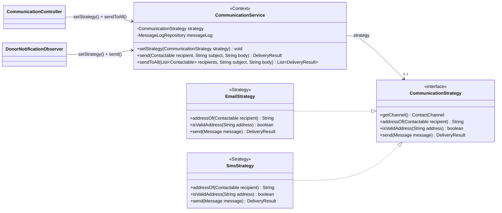
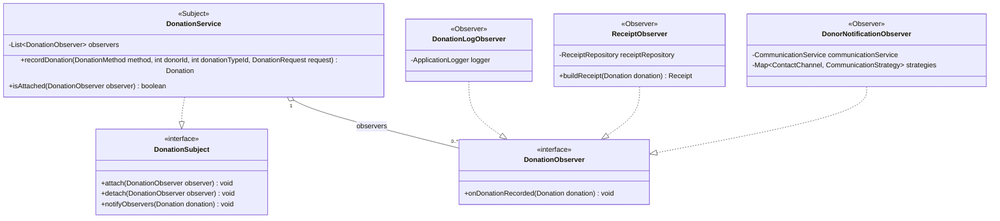
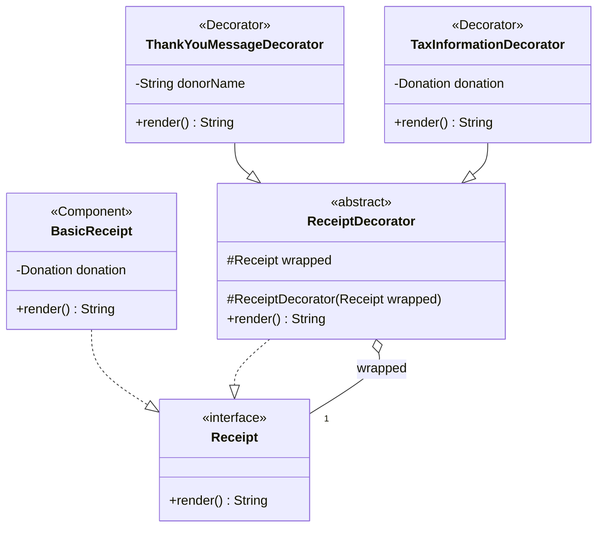
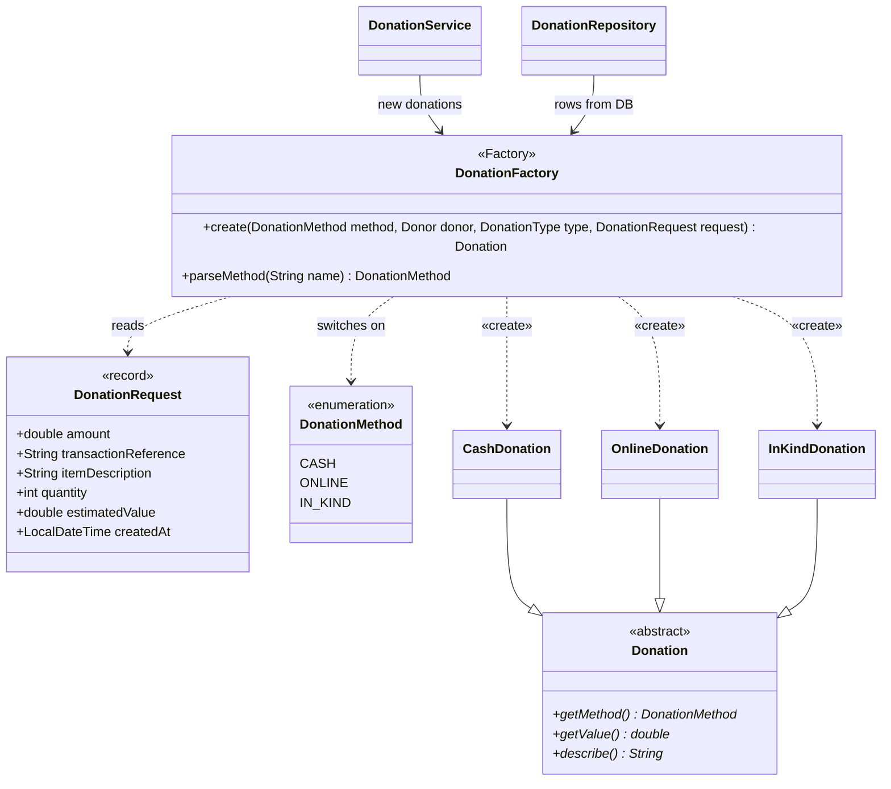
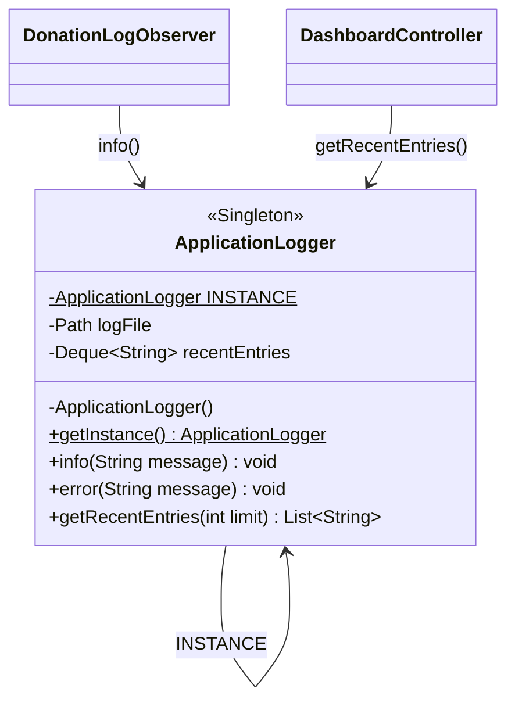
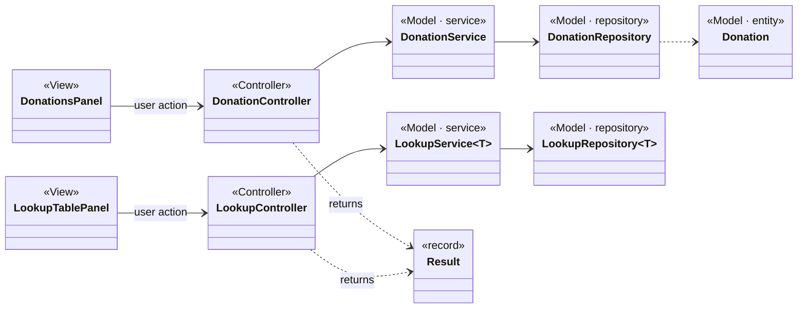

# Ripple — Class Diagram

> The complete UML class diagram of **Ripple**, Phase 1, plus one focused diagram per design pattern (section 5).

**This diagram is the team contract.** Whatever section of [PHASE1.md](../PHASE1.md) you are working on, create your classes **with exactly these names, fields and methods**. If you need to change a class, update this diagram in the same change. When the code is complete, `DiagramConsistencyTest` (Section 6) fails the build if code and diagram drift apart.

Related: [architecture.md](architecture.md) (layers, object wiring, sequence diagrams, database) · [PHASE1.md](../PHASE1.md) (who builds what)

---

## 1. How to read this diagram

### Arrows

| Notation (Mermaid) | UML name | Meaning in Ripple | Example |
|---|---|---|---|
| `A --\|> B` (solid line, hollow triangle) | **Generalization** (inheritance) | `A extends B` | `CashDonation --\|> Donation` |
| `A ..\|> B` (dashed line, hollow triangle) | **Realization** | `A implements B` (B is an interface) | `EmailStrategy ..\|> CommunicationStrategy` |
| `A --> B` (solid line, open arrow) | **Association** | `A` keeps a field of type `B` | `CommunicationService --> CommunicationStrategy` |
| `A o-- B` (hollow diamond at A) | **Aggregation** | `A` holds `B` but does not own its life; `B` is created elsewhere and passed in | `DonationService o-- DonationObserver` |
| `A *-- B` (filled diamond at A) | **Composition** | `A` creates and owns `B`; `B` lives and dies with `A` | `MainFrame *-- StatusBar` |
| `A ..> B` (dashed line, open arrow) | **Dependency** | `A` uses `B` only inside a method (parameter, return, local, or `new`) | `DonationFactory ..> CashDonation : «create»` |

### Multiplicities

Written at each end of an association: `"1"` exactly one, `"0..1"` optional, `"*"` / `"0..*"` many, `"2"` exactly two.
Example: `Donation "*" --> "1" Donor` — each donation has exactly one donor; a donor can have many donations.

### Member notation

| Symbol | Meaning |
|---|---|
| `+` / `-` / `#` | public / private / protected |
| `name()*` | abstract method |
| `name()$` / `field$` | static method / static field |
| `List~T~` | generic type, i.e. `List<T>` |
| `<<interface>>`, `<<abstract>>`, `<<enumeration>>`, `<<record>>` | kind of type |
| `<<Singleton>>`, `<<Subject>>`, `<<Observer>>`, `<<Strategy>>`, `<<Context>>`, `<<Component>>`, `<<Decorator>>`, `<<Factory>>` | the design-pattern role the class plays |

### What is left out on purpose

- **Plain getters and setters** (`getName()`, `setName(...)`) for the attributes shown — they would double the diagram's size and add nothing. Getters with real logic (e.g. `getReceiptNumber()`) **are** shown.
- **Constructors**, except where the constructor is part of the pattern (the Singleton's private constructor, the decorator's protected constructor).
- **Swing widget fields inside views** (text fields, tables, buttons) and their small private helper methods. Views show only the controllers and status bar they depend on.
- **`toString()` overrides** that only return a display name for combo boxes (`Donor`, `DonationMethod`).
- **Swing and JDK classes** (`JPanel`, `JFrame`, `RuntimeException`). Inheritance from them is stated in the class tables below.

---

## 2. Complete diagram

Packages are drawn as namespaces (`com.ripple.<namespace>`).

```mermaid
classDiagram
direction TB

%% ===================== model =====================
namespace model {
    class Contactable {
        <<interface>>
        +getName() String
        +getEmail() String
        +getPhone() String
    }
    class ContactChannel {
        <<enumeration>>
        EMAIL
        SMS
    }
    class DonationMethod {
        <<enumeration>>
        CASH
        ONLINE
        IN_KIND
        +getLabel() String
    }
    class Donor {
        -int id
        -String name
        -String email
        -String phone
        -ContactChannel preferredChannel
    }
    class Donation {
        <<abstract>>
        -int id
        -Donor donor
        -DonationType donationType
        -LocalDateTime createdAt
        +getMethod()* DonationMethod
        +getValue()* double
        +describe()* String
        +getReceiptNumber() String
        +isTaxDeductible() boolean
    }
    class CashDonation {
        -double amount
        +getMethod() DonationMethod
        +getValue() double
        +describe() String
    }
    class OnlineDonation {
        -double amount
        -String transactionReference
        +getMethod() DonationMethod
        +getValue() double
        +describe() String
    }
    class InKindDonation {
        -String itemDescription
        -int quantity
        -double estimatedValue
        +getMethod() DonationMethod
        +getValue() double
        +describe() String
    }
    class LookupEntry {
        <<abstract>>
        -int id
        -String name
        -String description
        +toString() String
    }
    class DonationType {
        -boolean taxDeductible
    }
    class EventCategory
    class Volunteer {
        -int id
        -String name
        -String email
        -String phone
        -String skills
        -String availability
    }
    class Event {
        -int id
        -String name
        -EventCategory category
        -LocalDate eventDate
        -String location
        -String description
    }
    class Attendee {
        -int id
        -int eventId
        -String name
        -String email
        -String phone
    }
    class Beneficiary {
        -int id
        -String name
        -String email
        -String phone
        -String address
        -String needs
    }
}

%% ===================== factory =====================
namespace factory {
    class DonationFactory {
        <<Factory>>
        +create(DonationMethod method, Donor donor, DonationType type, DonationRequest request) Donation
        +parseMethod(String name) DonationMethod
        -createCash(Donor, DonationType, DonationRequest) CashDonation
        -createOnline(Donor, DonationType, DonationRequest) OnlineDonation
        -createInKind(Donor, DonationType, DonationRequest) InKindDonation
        -requirePositiveAmount(double amount)$ void
        -createdAtOf(DonationRequest request)$ LocalDateTime
    }
    class DonationRequest {
        <<record>>
        +double amount
        +String transactionReference
        +String itemDescription
        +int quantity
        +double estimatedValue
        +LocalDateTime createdAt
    }
}

%% ===================== observer =====================
namespace observer {
    class DonationSubject {
        <<interface>>
        +attach(DonationObserver observer) void
        +detach(DonationObserver observer) void
        +notifyObservers(Donation donation) void
    }
    class DonationObserver {
        <<interface>>
        +onDonationRecorded(Donation donation) void
    }
    class DonationLogObserver {
        <<Observer>>
        -ApplicationLogger logger
        +onDonationRecorded(Donation donation) void
    }
    class ReceiptObserver {
        <<Observer>>
        -ReceiptRepository receiptRepository
        +onDonationRecorded(Donation donation) void
        +buildReceipt(Donation donation) Receipt
    }
    class DonorNotificationObserver {
        <<Observer>>
        -CommunicationService communicationService
        -Map~ContactChannel, CommunicationStrategy~ strategies
        +onDonationRecorded(Donation donation) void
    }
}

%% ===================== receipt =====================
namespace receipt {
    class Receipt {
        <<interface>>
        +render() String
    }
    class BasicReceipt {
        <<Component>>
        -Donation donation
        +render() String
    }
    class ReceiptDecorator {
        <<abstract>>
        #Receipt wrapped
        #ReceiptDecorator(Receipt wrapped)
        +render() String
    }
    class ThankYouMessageDecorator {
        <<Decorator>>
        -String donorName
        +render() String
    }
    class TaxInformationDecorator {
        <<Decorator>>
        -Donation donation
        +render() String
    }
}

%% ===================== communication =====================
namespace communication {
    class CommunicationStrategy {
        <<interface>>
        +getChannel() ContactChannel
        +addressOf(Contactable recipient) String
        +isValidAddress(String address) boolean
        +send(Message message) DeliveryResult
    }
    class EmailStrategy {
        <<Strategy>>
        +getChannel() ContactChannel
        +addressOf(Contactable recipient) String
        +isValidAddress(String address) boolean
        +send(Message message) DeliveryResult
    }
    class SmsStrategy {
        <<Strategy>>
        +getChannel() ContactChannel
        +addressOf(Contactable recipient) String
        +isValidAddress(String address) boolean
        +send(Message message) DeliveryResult
    }
    class CommunicationService {
        <<Context>>
        -CommunicationStrategy strategy
        -MessageLogRepository messageLog
        +setStrategy(CommunicationStrategy strategy) void
        +getStrategy() CommunicationStrategy
        +send(Contactable recipient, String subject, String body) DeliveryResult
        +sendToAll(List~Contactable~ recipients, String subject, String body) List~DeliveryResult~
    }
    class Message {
        <<record>>
        +String recipientName
        +String address
        +String subject
        +String body
    }
    class DeliveryResult {
        <<record>>
        +boolean success
        +String status
        +String detail
        +simulated(String detail)$ DeliveryResult
        +failed(String detail)$ DeliveryResult
    }
    class MessageLogEntry {
        <<record>>
        +int id
        +ContactChannel channel
        +String recipient
        +String subject
        +String body
        +String status
        +LocalDateTime sentAt
    }
}

%% ===================== logging =====================
namespace logging {
    class ApplicationLogger {
        <<Singleton>>
        -ApplicationLogger INSTANCE$
        -Path logFile
        -Deque~String~ recentEntries
        -ApplicationLogger()
        +getInstance()$ ApplicationLogger
        +info(String message) void
        +error(String message) void
        +getRecentEntries(int limit) List~String~
        -write(String level, String message) void
    }
}

%% ===================== repository =====================
namespace repository {
    class Database {
        +String DEFAULT_PATH$
        -String url
        +fromEnvironment()$ Database
        +getConnection() Connection
        +initialize() void
        -seedIfEmpty(Connection, String table, String insertSql, Object[][] rows) void
    }
    class LookupRepository~T~ {
        <<interface>>
        +findAll() List~T~
        +findById(int id) Optional~T~
        +existsByName(String name, int excludeId) boolean
        +insert(T entry) T
        +update(T entry) void
        +delete(int id) void
        +countUsages(int id) int
    }
    class DonationTypeRepository {
        -Database database
    }
    class EventCategoryRepository {
        -Database database
    }
    class DonorRepository {
        -Database database
        +findAll() List~Donor~
        +findById(int id) Optional~Donor~
        +insert(Donor donor) Donor
        +count() int
    }
    class DonationRepository {
        -Database database
        -DonationFactory factory
        +insert(Donation donation) Donation
        +findAll() List~Donation~
        +count() int
        +totalValue() double
    }
    class ReceiptRepository {
        -Database database
        +save(int donationId, String content) void
        +findByDonationId(int donationId) Optional~String~
    }
    class VolunteerRepository {
        -Database database
        +findAll() List~Volunteer~
        +insert(Volunteer volunteer) Volunteer
        +update(Volunteer volunteer) void
        +delete(int id) void
        +count() int
        +assignToEvent(int volunteerId, int eventId) void
        +findByEvent(int eventId) List~Volunteer~
    }
    class EventRepository {
        -Database database
        +findAll() List~Event~
        +findById(int id) Optional~Event~
        +insert(Event event) Event
        +update(Event event) void
        +delete(int id) void
        +count() int
        +addAttendee(Attendee attendee) Attendee
        +findAttendees(int eventId) List~Attendee~
    }
    class BeneficiaryRepository {
        -Database database
        +findAll() List~Beneficiary~
        +insert(Beneficiary beneficiary) Beneficiary
        +update(Beneficiary beneficiary) void
        +delete(int id) void
        +count() int
    }
    class MessageLogRepository {
        -Database database
        +save(ContactChannel channel, Message message, DeliveryResult result) void
        +findAll() List~MessageLogEntry~
    }
}

%% ===================== service =====================
namespace service {
    class ValidationException {
        +ValidationException(String message)
    }
    class InputValidator {
        +requireText(String value, String field, int min, int max)$ String
        +isValidEmail(String value)$ boolean
        +isValidPhone(String value)$ boolean
        +parseDouble(String value, String field)$ double
        +parseInt(String value, String field)$ int
    }
    class LookupService~T~ {
        -LookupRepository~T~ repository
        -String entityLabel
        +findAll() List~T~
        +add(T entry) T
        +update(T entry) void
        +delete(int id) void
        -validate(T entry) void
    }
    class DonationService {
        <<Subject>>
        -List~DonationObserver~ observers
        -DonationFactory factory
        -DonorRepository donorRepository
        -DonationRepository donationRepository
        -LookupRepository~DonationType~ donationTypeRepository
        +attach(DonationObserver observer) void
        +detach(DonationObserver observer) void
        +notifyObservers(Donation donation) void
        +isAttached(DonationObserver observer) boolean
        +registerDonor(String name, String email, String phone, ContactChannel channel) Donor
        +findAllDonors() List~Donor~
        +recordDonation(DonationMethod method, int donorId, int donationTypeId, DonationRequest request) Donation
        +findAllDonations() List~Donation~
    }
}

%% ===================== controller =====================
namespace controller {
    class Result {
        <<record>>
        +boolean success
        +String message
        +ok(String message)$ Result
        +fail(String message)$ Result
    }
    class DashboardSummary {
        <<record>>
        +int donors
        +int donations
        +double totalDonationValue
        +int volunteers
        +int events
        +int beneficiaries
        +List~String~ recentActivity
    }
    class LookupKind {
        <<enumeration>>
        DONATION_TYPE
        EVENT_CATEGORY
        +getTitle() String
        +hasTaxFlag() boolean
    }
    class Audience {
        <<enumeration>>
        DONORS
        VOLUNTEERS
        BENEFICIARIES
        EVENT_ATTENDEES
    }
    class LookupController {
        -LookupService~DonationType~ donationTypes
        -LookupService~EventCategory~ eventCategories
        +list(LookupKind kind) List~LookupEntry~
        +listDonationTypes() List~DonationType~
        +listEventCategories() List~EventCategory~
        +save(LookupKind kind, Integer id, String name, String description, boolean taxDeductible) Result
        +delete(LookupKind kind, int id) Result
    }
    class DonationController {
        -DonationService donationService
        -ReceiptRepository receiptRepository
        -DonorNotificationObserver donorNotifier
        +listDonors() List~Donor~
        +registerDonor(String name, String email, String phone, String channel) Result
        +recordDonation(int donorId, int typeId, String method, String amount, String transactionRef, String item, String quantity, String estimatedValue) Result
        +listDonations() List~Donation~
        +getReceipt(int donationId) String
        +setDonorNotifications(boolean enabled) void
        +isDonorNotificationsEnabled() boolean
    }
    class VolunteerController {
        -VolunteerRepository volunteerRepository
        +listVolunteers() List~Volunteer~
        +saveVolunteer(Integer id, String name, String email, String phone, String skills, String availability) Result
        +deleteVolunteer(int id) Result
        +assignToEvent(int volunteerId, int eventId) Result
    }
    class EventController {
        -EventRepository eventRepository
        -VolunteerRepository volunteerRepository
        +listEvents() List~Event~
        +saveEvent(Integer id, String name, int categoryId, String date, String location, String description) Result
        +deleteEvent(int id) Result
        +registerAttendee(int eventId, String name, String email, String phone) Result
        +listAttendees(int eventId) List~Attendee~
        +listVolunteers(int eventId) List~Volunteer~
    }
    class BeneficiaryController {
        -BeneficiaryRepository beneficiaryRepository
        +listBeneficiaries() List~Beneficiary~
        +saveBeneficiary(Integer id, String name, String email, String phone, String address, String needs) Result
        +deleteBeneficiary(int id) Result
    }
    class CommunicationController {
        -CommunicationService communicationService
        -Map~ContactChannel, CommunicationStrategy~ strategies
        -DonorRepository donorRepository
        -VolunteerRepository volunteerRepository
        -BeneficiaryRepository beneficiaryRepository
        -EventRepository eventRepository
        -MessageLogRepository messageLogRepository
        +sendToGroup(Audience audience, Integer eventId, String channel, String subject, String body) Result
        +listMessageLog() List~MessageLogEntry~
    }
    class DashboardController {
        -DonorRepository donorRepository
        -DonationRepository donationRepository
        -VolunteerRepository volunteerRepository
        -EventRepository eventRepository
        -BeneficiaryRepository beneficiaryRepository
        -ApplicationLogger logger
        +getSummary() DashboardSummary
    }
}

%% ===================== view =====================
namespace view {
    class Refreshable {
        <<interface>>
        +refresh() void
    }
    class StatusBar {
        +showResult(Result result) void
    }
    class MainFrame {
        -CardLayout cards
        -JPanel content
        -StatusBar statusBar
        -Map~String, JPanel~ cardsByName
        -Map~String, Refreshable~ screens
        -String currentScreen
        +addScreen(String name, JPanel screen) void
        +getStatusBar() StatusBar
        -showScreen(String name) void
    }
    class DashboardPanel {
        -DashboardController controller
        +refresh() void
    }
    class DonationsPanel {
        -DonationController donationController
        -LookupController lookupController
        -StatusBar statusBar
        +refresh() void
    }
    class VolunteersPanel {
        -VolunteerController volunteerController
        -EventController eventController
        -StatusBar statusBar
        +refresh() void
    }
    class EventsPanel {
        -EventController eventController
        -LookupController lookupController
        -StatusBar statusBar
        +refresh() void
    }
    class BeneficiariesPanel {
        -BeneficiaryController controller
        -StatusBar statusBar
        +refresh() void
    }
    class CommunicationPanel {
        -CommunicationController communicationController
        -EventController eventController
        -StatusBar statusBar
        +refresh() void
    }
    class LookupPanel {
        -LookupTablePanel donationTypesTab
        -LookupTablePanel eventCategoriesTab
        +refresh() void
    }
    class LookupTablePanel {
        -LookupController controller
        -LookupKind kind
        -StatusBar statusBar
        +refresh() void
    }
}

%% ===================== app =====================
namespace app {
    class Main {
        +main(String[] args)$ void
    }
}

%% ---------- model relationships ----------
Donor ..|> Contactable
Volunteer ..|> Contactable
Attendee ..|> Contactable
Beneficiary ..|> Contactable
Donor "*" --> "1" ContactChannel : preferredChannel
CashDonation --|> Donation
OnlineDonation --|> Donation
InKindDonation --|> Donation
Donation "*" --> "1" Donor : donor
Donation "*" --> "1" DonationType : donationType
Donation ..> DonationMethod
DonationType --|> LookupEntry
EventCategory --|> LookupEntry
Event "*" --> "1" EventCategory : category
Attendee "*" --> "1" Event : eventId
Event "*" -- "*" Volunteer : assigned via event_volunteers

%% ---------- Factory ----------
DonationFactory ..> DonationRequest : reads
DonationFactory ..> CashDonation : «create»
DonationFactory ..> OnlineDonation : «create»
DonationFactory ..> InKindDonation : «create»
DonationFactory ..> ValidationException : throws

%% ---------- Observer ----------
DonationService ..|> DonationSubject
DonationLogObserver ..|> DonationObserver
ReceiptObserver ..|> DonationObserver
DonorNotificationObserver ..|> DonationObserver
DonationService "1" o-- "0..*" DonationObserver : observers
DonationLogObserver --> "1" ApplicationLogger
ReceiptObserver --> "1" ReceiptRepository
DonorNotificationObserver --> "1" CommunicationService
DonorNotificationObserver --> "2" CommunicationStrategy : strategies

%% ---------- Decorator ----------
BasicReceipt ..|> Receipt
ReceiptDecorator ..|> Receipt
ReceiptDecorator o-- "1" Receipt : wrapped
ThankYouMessageDecorator --|> ReceiptDecorator
TaxInformationDecorator --|> ReceiptDecorator
BasicReceipt --> "1" Donation
TaxInformationDecorator --> "1" Donation
ReceiptObserver ..> BasicReceipt : «create»
ReceiptObserver ..> ThankYouMessageDecorator : «create»
ReceiptObserver ..> TaxInformationDecorator : «create»

%% ---------- Strategy ----------
EmailStrategy ..|> CommunicationStrategy
SmsStrategy ..|> CommunicationStrategy
CommunicationService --> "0..1" CommunicationStrategy : strategy
CommunicationService --> "1" MessageLogRepository
CommunicationService ..> Message
CommunicationService ..> DeliveryResult
CommunicationStrategy ..> Contactable
CommunicationStrategy ..> ContactChannel

%% ---------- repositories ----------
DonationTypeRepository ..|> LookupRepository
EventCategoryRepository ..|> LookupRepository
DonationTypeRepository --> Database
EventCategoryRepository --> Database
DonorRepository --> Database
DonationRepository --> Database
DonationRepository --> "1" DonationFactory : rebuilds rows
ReceiptRepository --> Database
VolunteerRepository --> Database
EventRepository --> Database
BeneficiaryRepository --> Database
MessageLogRepository --> Database
MessageLogRepository ..> MessageLogEntry

%% ---------- services ----------
LookupService --> "1" LookupRepository
LookupService ..> InputValidator
LookupService ..> ValidationException : throws
DonationService --> "1" DonationFactory
DonationService --> "1" DonorRepository
DonationService --> "1" DonationRepository
DonationService --> "1" LookupRepository : donation types
DonationService ..> InputValidator

%% ---------- controllers ----------
LookupController --> "2" LookupService
LookupController ..> LookupKind
LookupController ..> ApplicationLogger : logs changes
DonationController --> "1" DonationService
DonationController --> "1" ReceiptRepository
DonationController --> "1" DonorNotificationObserver : attach / detach
VolunteerController --> "1" VolunteerRepository
EventController --> "1" EventRepository
EventController --> "1" VolunteerRepository
BeneficiaryController --> "1" BeneficiaryRepository
CommunicationController --> "1" CommunicationService
CommunicationController --> "2" CommunicationStrategy : strategies
CommunicationController --> "1" MessageLogRepository
CommunicationController ..> Audience
DashboardController --> "1" ApplicationLogger
DashboardController ..> DashboardSummary : «create»
LookupController ..> Result
DonationController ..> Result
VolunteerController ..> Result
EventController ..> Result
BeneficiaryController ..> Result
CommunicationController ..> Result

%% ---------- views ----------
MainFrame *-- "1" StatusBar
MainFrame *-- "1" DashboardPanel
MainFrame *-- "1" DonationsPanel
MainFrame *-- "1" VolunteersPanel
MainFrame *-- "1" EventsPanel
MainFrame *-- "1" BeneficiariesPanel
MainFrame *-- "1" CommunicationPanel
MainFrame *-- "1" LookupPanel
LookupPanel *-- "2" LookupTablePanel
DashboardPanel ..|> Refreshable
DonationsPanel ..|> Refreshable
VolunteersPanel ..|> Refreshable
EventsPanel ..|> Refreshable
BeneficiariesPanel ..|> Refreshable
CommunicationPanel ..|> Refreshable
LookupPanel ..|> Refreshable
LookupTablePanel ..|> Refreshable
DashboardPanel --> DashboardController
DonationsPanel --> DonationController
DonationsPanel --> LookupController
VolunteersPanel --> VolunteerController
VolunteersPanel --> EventController
EventsPanel --> EventController
EventsPanel --> LookupController
BeneficiariesPanel --> BeneficiaryController
CommunicationPanel --> CommunicationController
CommunicationPanel --> EventController
LookupTablePanel --> LookupController
StatusBar ..> Result

%% ---------- composition root ----------
Main ..> Database : «create»
Main ..> MainFrame : «create»
```

> `DashboardController` also holds the five counting repositories (`DonorRepository`, `DonationRepository`, `VolunteerRepository`, `EventRepository`, `BeneficiaryRepository`), and `CommunicationController` holds the four repositories it reads recipients from. Those arrows are listed as fields in the classes rather than drawn, to keep the picture readable.

---

## 3. Classes by package

### `com.ripple.model` — domain entities (Model)
| Class | Kind | Responsibility |
|---|---|---|
| `Contactable` | interface | Anything Ripple can message: name, email, phone. Lets communication treat donors, volunteers, attendees and beneficiaries the same way (polymorphism). |
| `ContactChannel` | enum | `EMAIL`, `SMS`. |
| `DonationMethod` | enum | `CASH`, `ONLINE`, `IN_KIND` — the key the factory switches on. |
| `Donor` | class | A person or company that donates; has a preferred channel (CR5). |
| `Donation` | abstract class | Common donation data (donor, type, timestamp — CR3) and the abstract operations each kind must define. |
| `CashDonation`, `OnlineDonation`, `InKindDonation` | classes | The three concrete donation kinds; each computes its own `getValue()` and `describe()`. |
| `LookupEntry` | abstract class | Shared shape of lookup rows: id, name, description. |
| `DonationType` | class | Lookup row, plus the tax-deductible flag (CR4). |
| `EventCategory` | class | Lookup row. |
| `Volunteer`, `Event`, `Attendee`, `Beneficiary` | classes | Entities of the other modules. |

### `com.ripple.factory` — Factory pattern
| Class | Kind | Responsibility |
|---|---|---|
| `DonationFactory` | class | The **only** place that decides which `Donation` subclass to build and validates its method-specific fields. Unknown methods throw `ValidationException`. |
| `DonationRequest` | record | Carries the already-parsed form values into the factory. |

### `com.ripple.observer` — Observer pattern
| Class | Kind | Responsibility |
|---|---|---|
| `DonationSubject` | interface | attach / detach / notify. |
| `DonationObserver` | interface | `onDonationRecorded(donation)`. |
| `DonationLogObserver` | class | Writes the donation to the application log. |
| `ReceiptObserver` | class | Builds the decorated receipt and stores it. |
| `DonorNotificationObserver` | class | Picks the strategy for the donor's preferred channel and sends a thank-you. |

### `com.ripple.receipt` — Decorator pattern
| Class | Kind | Responsibility |
|---|---|---|
| `Receipt` | interface | Component: `render()` returns the receipt text. |
| `BasicReceipt` | class | Concrete component: receipt number, date, donor, type, method, value. |
| `ReceiptDecorator` | abstract class | Holds a wrapped `Receipt` and delegates to it. |
| `ThankYouMessageDecorator` | class | Appends a personal thank-you. |
| `TaxInformationDecorator` | class | Appends the tax-deductible statement and amount. |

### `com.ripple.communication` — Strategy pattern
| Class | Kind | Responsibility |
|---|---|---|
| `CommunicationStrategy` | interface | One way of sending a message: which address to use, how to validate it, how to send. |
| `EmailStrategy`, `SmsStrategy` | classes | Simulated email / SMS (console output, status `SIMULATED`). |
| `CommunicationService` | class | Context: holds the current strategy, validates, sends, writes the message log. |
| `Message`, `DeliveryResult`, `MessageLogEntry` | records | Data passed in and out. |

### `com.ripple.logging` — Singleton pattern
| Class | Kind | Responsibility |
|---|---|---|
| `ApplicationLogger` | class | The one shared log: appends to `logs/ripple.log` and keeps recent entries for the Dashboard. |

### `com.ripple.repository` — persistence (Model)
| Class | Responsibility |
|---|---|
| `Database` | Connection URL (from `RIPPLE_DB_PATH`), opens connections with foreign keys on, creates schema and seed data. |
| `LookupRepository<T>` | Common contract for both lookup tables, including `countUsages` for CR2. |
| `DonationTypeRepository`, `EventCategoryRepository` | SQL for the two lookup tables. |
| `DonorRepository`, `DonationRepository`, `ReceiptRepository`, `VolunteerRepository`, `EventRepository`, `BeneficiaryRepository`, `MessageLogRepository` | SQL for each table group. `DonationRepository` uses `DonationFactory` to rebuild the right subclass from a row. |

### `com.ripple.service` — business rules (Model)
| Class | Responsibility |
|---|---|
| `LookupService<T>` | One implementation of the lookup rules (CR1, CR2) used for both tables. |
| `DonationService` | Registers donors, records donations through the factory, and is the Observer **Subject**. |
| `InputValidator` | Shared static checks and parsing (text length, email, phone, numbers). |
| `ValidationException` | `extends RuntimeException`; carries a message meant for the user. |

### `com.ripple.controller` — Controllers
| Class | Responsibility |
|---|---|
| `LookupController`, `DonationController`, `VolunteerController`, `EventController`, `BeneficiaryController`, `CommunicationController`, `DashboardController` | One per screen. Parse UI strings, call services/repositories, turn exceptions into `Result`. |
| `Result` | Success flag + message for the status bar (CR6). |
| `DashboardSummary` | Numbers and recent activity for the Dashboard. |
| `LookupKind`, `Audience` | Which lookup table / which recipient group the user picked. |

### `com.ripple.view` — Views (Swing)
| Class | Responsibility |
|---|---|
| `MainFrame` | `extends JFrame`. The **User Control Panel**: sidebar, `CardLayout` content area, status bar. |
| `DashboardPanel`, `DonationsPanel`, `VolunteersPanel`, `EventsPanel`, `BeneficiariesPanel`, `CommunicationPanel`, `LookupPanel` | `extends JPanel`. One screen each. |
| `LookupTablePanel` | `extends JPanel`. Reusable list/add/edit/delete table, used once per `LookupKind`. |
| `StatusBar` | `extends JLabel`. Shows a `Result` in green or red. |
| `Refreshable` | Implemented by every screen so `MainFrame` can reload data when a screen is shown. |

### `com.ripple.app`
| Class | Responsibility |
|---|---|
| `Main` | Composition root (see [architecture.md §4](architecture.md#4-composition-root-object-wiring)). |

---

## 4. Key relationships explained

| Relationship | Why it is drawn this way |
|---|---|
| `Donation "*" --> "1" Donor` | Each donation object keeps a reference to its donor; one donor makes many donations. |
| `Donation "*" --> "1" DonationType` | Each donation is classified by exactly one lookup value — this is what makes CR2 (no delete while in use) necessary. |
| `Event "*" -- "*" Volunteer` | Many-to-many, stored in the `event_volunteers` join table. Neither class holds a list of the other; the repositories query the link. |
| `Attendee "*" --> "1" Event` | An attendee row belongs to one event (`eventId`). |
| `DonationService "1" o-- "0..*" DonationObserver` | **Aggregation**: observers are created in `Main` and attached; the service only holds them. Zero observers is valid. |
| `ReceiptDecorator o-- "1" Receipt` | The heart of Decorator: a decorator **is-a** `Receipt` (realization) and **has-a** `Receipt` (aggregation). |
| `CommunicationService --> "0..1" CommunicationStrategy` | The context holds at most one current strategy and can swap it at runtime. |
| `DonationFactory ..> CashDonation : «create»` | Dependency, not association: the factory does not keep the objects it creates. |
| `MainFrame *-- DashboardPanel` | **Composition**: the frame creates its panels and they live only inside it. |
| `ApplicationLogger` → itself (static `INSTANCE`) | The Singleton holds its own only instance in a private static field. |

---

## 5. Pattern views

One small diagram per design pattern (sized for a slide), cut out of the complete diagram above: same class names and members, only what that pattern needs. The section of `PHASE1.md` that implements a pattern adds a short **"In the code / Demo / Test"** note under its diagram.

| Pattern | Rubric | Package | Problem it solves | Section |
|---|---|---|---|---|
| Strategy | 1 | `communication` | Choose Email or SMS at runtime without `if/else` on the channel | 5 |
| Observer | 1 | `observer` + `DonationService` | Several things must happen after a donation is recorded, without the donation code knowing them | 2 |
| Decorator | 1 | `receipt` | Add optional receipt sections (thank-you, tax info) without changing the basic receipt | 3 |
| Factory | 0.5 | `factory` | One place decides which `Donation` subclass to build and validates it | 1 |
| Singleton | 0.5 | `logging` | Exactly one shared application log | 1 |
| MVC | 2 | all | Keep UI, coordination and business rules apart | all, checked in 6 |
### 5.1 Strategy — communication channels

**Roles:** Strategy = `CommunicationStrategy` · Concrete strategies = `EmailStrategy`, `SmsStrategy` · Context = `CommunicationService` · Clients = `CommunicationController`, `DonorNotificationObserver`.



**How it works:** the user picks "SMS" in the Communication screen → the controller calls `communicationService.setStrategy(strategies.get(SMS))` → `sendToAll(...)` asks the *current* strategy for each recipient's address (`addressOf`), validates it (`isValidAddress`) and sends (`send`). `CommunicationService` never mentions `EmailStrategy` or `SmsStrategy` by name.
**Honesty note:** both strategies are simulations; they print to the console and return status `SIMULATED`.
**Extending:** a real provider (e.g. WhatsApp) = one new class implementing `CommunicationStrategy`; nothing else changes.

---

### 5.2 Observer — reacting to a new donation

**Roles:** Subject = `DonationSubject` / concrete subject `DonationService` · Observer = `DonationObserver` · Concrete observers = `DonationLogObserver`, `ReceiptObserver`, `DonorNotificationObserver`.



**How it works:** `recordDonation(...)` saves the donation and then calls `notifyObservers(donation)`, which loops over the list and calls `onDonationRecorded` on each one. The donation code does not know *what* the observers do.
**Unsubscribe in the app:** the "Notify donors on new donation" checkbox in the Donations screen calls `detach(donorNotifier)` / `attach(donorNotifier)`. Record a donation with it unticked and no message appears in the message log.
**Link to other patterns:** `ReceiptObserver` uses the Decorator; `DonorNotificationObserver` uses the Strategy; `DonationLogObserver` uses the Singleton.

---

### 5.3 Decorator — donation receipts

**Roles:** Component = `Receipt` · Concrete component = `BasicReceipt` · Decorator = `ReceiptDecorator` · Concrete decorators = `ThankYouMessageDecorator`, `TaxInformationDecorator`.



**How it works:** each decorator's `render()` returns `wrapped.render()` plus its own section. `ReceiptObserver` builds the chain at runtime:

```java
Receipt receipt = new ThankYouMessageDecorator(new BasicReceipt(donation), donor.getName());
if (donation.isTaxDeductible()) {
    receipt = new TaxInformationDecorator(receipt, donation);   // CR4
}
String text = receipt.render();
```

`BasicReceipt` has no `if (showTax)` flag and is never edited to add sections — that is the point of the pattern. Same idea as the course lab's pizza toppings (`Pizza` / `ToppingDecorator`).

---

### 5.4 Factory — creating donations

**Roles:** Factory = `DonationFactory` · Product = `Donation` · Concrete products = `CashDonation`, `OnlineDonation`, `InKindDonation` · Client = `DonationService` (and `DonationRepository` when loading rows).



**How it works:** `create(...)` switches on the method, checks the fields that method needs (online needs a transaction reference, in-kind needs a quantity > 0, ...) and returns the right subclass as a `Donation`. `parseMethod("CHEQUE")` throws `ValidationException("Unsupported donation method: CHEQUE")`. Callers only ever see `Donation`, so receipts, tables and the dashboard total use `getValue()` polymorphically.

- **In the code:** [DonationFactory.java](../src/main/java/com/ripple/factory/DonationFactory.java), method `create(...)` and its `switch`. Products are in `com.ripple.model` (`CashDonation`, `OnlineDonation`, `InKindDonation`).
- **Demo:** run `DonationFactoryTest` and show `create(...)`. From Section 2 on, the Donations screen records every donation through it (try an in-kind donation with quantity 0 to see the factory reject it).
- **Test:** `src/test/java/com/ripple/factory/DonationFactoryTest.java` checks that each method gives the right subclass, rejects invalid details and unsupported methods, and keeps stored timestamps.

---

### 5.5 Singleton — application logger

**Role:** Singleton = `ApplicationLogger`. Used by `DonationLogObserver` (writes) and `DashboardController` (reads recent entries).



**How it works:** the constructor is `private`, so no other class can call `new ApplicationLogger()`. The single instance is created when the class is loaded (`private static final ApplicationLogger INSTANCE = new ApplicationLogger();`), which the JVM guarantees happens once, so it is thread-safe without `synchronized`.
**Why this class deserves to be a Singleton:** there is one log file (`logs/ripple.log`) and one recent-activity feed on the Dashboard. Two logger objects would write the same file independently and each would see only half the activity.
**Why nothing else is a Singleton:** `Database` and the services are passed through constructors so tests can give each one its own temporary database.

- **In the code:** [ApplicationLogger.java](../src/main/java/com/ripple/logging/ApplicationLogger.java): the private constructor, `INSTANCE` and `getInstance()`. Used by `Main` ("Ripple started") and `LookupController` (every add, update or delete), and later by `DonationLogObserver` and the Dashboard.
- **Demo:** add or delete a lookup value, then open `logs/ripple.log` and show the new line. Point out that `new ApplicationLogger()` does not compile outside the class.
- **Test:** `src/test/java/com/ripple/logging/ApplicationLoggerTest.java` checks that `getInstance()` returns the same object every time and that entries come back newest first.

---

### 5.6 MVC — layers



**Rule:** arrows only point to the right. A view never imports a repository or `java.sql`; a service never imports Swing. Full explanation in [architecture.md](architecture.md#2-mvc-with-a-thin-service-layer).
