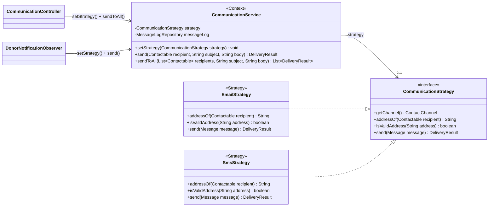
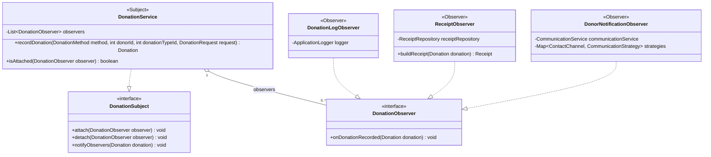
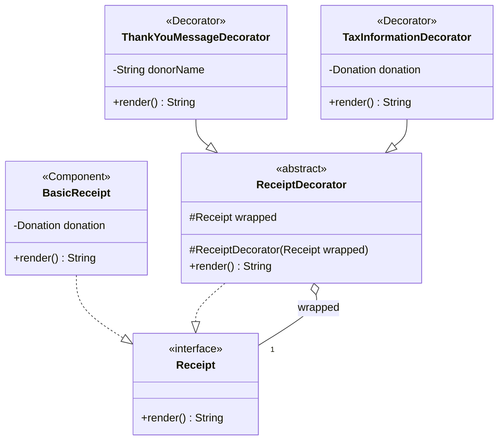
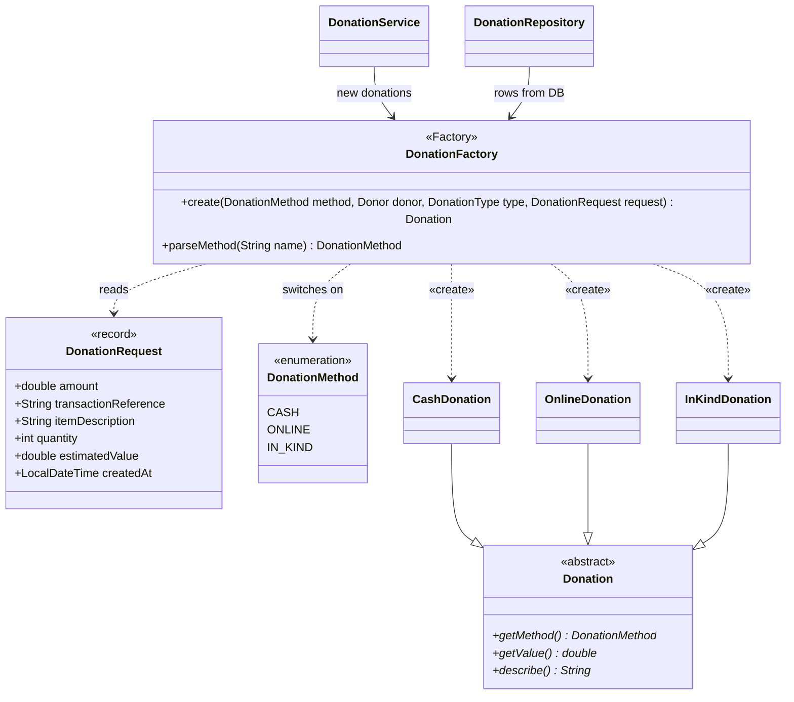
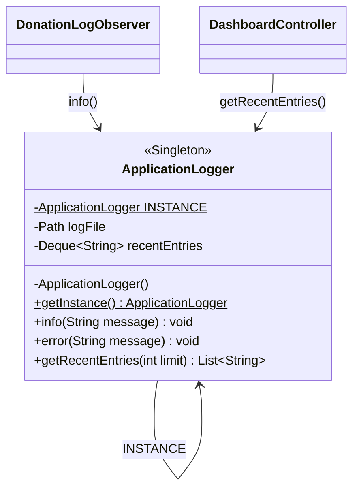
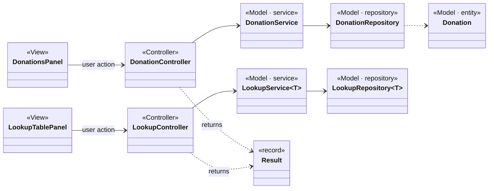

# Ripple — Pattern Diagrams

> One small class diagram per design pattern in **Ripple**, Phase 1, sized for a slide.
> Each one is a **cut-out of the [complete class diagram](class-diagram.md)**: the same class names and members, showing only what that pattern needs.
> Each pattern also gets its own full write-up in `docs/patterns/` as it is implemented (code excerpt, demo steps, test, Q&A).

| # | Pattern | Rubric | Where in Ripple | Problem it solves |
|---|---|---|---|---|
| 1 | Strategy | 1 mark | `com.ripple.communication` | Choose Email or SMS at runtime without `if/else` on channel. |
| 2 | Observer | 1 mark | `com.ripple.observer` + `DonationService` | Several things must happen after a donation is recorded, without the donation code knowing them. |
| 3 | Decorator | 1 mark | `com.ripple.receipt` | Add optional sections (thank-you, tax info) to a receipt without changing the basic receipt. |
| 4 | Factory | 0.5 | `com.ripple.factory` | One place decides which `Donation` subclass to build and validates it. |
| 5 | Singleton | 0.5 | `com.ripple.logging` | Exactly one shared application log. |
| 6 | MVC | 2 marks | all packages | Keep UI, coordination and business rules apart. |

---

## 1. Strategy — communication channels

**Roles:** Strategy = `CommunicationStrategy` · Concrete strategies = `EmailStrategy`, `SmsStrategy` · Context = `CommunicationService` · Clients = `CommunicationController`, `DonorNotificationObserver`.



**How it works:** the user picks "SMS" in the Communication screen → the controller calls `communicationService.setStrategy(strategies.get(SMS))` → `sendToAll(...)` asks the *current* strategy for each recipient's address (`addressOf`), validates it (`isValidAddress`) and sends (`send`). `CommunicationService` never mentions `EmailStrategy` or `SmsStrategy` by name.
**Honesty note:** both strategies are simulations; they print to the console and return status `SIMULATED`.
**Extending:** a real provider (e.g. WhatsApp) = one new class implementing `CommunicationStrategy`; nothing else changes.

---

## 2. Observer — reacting to a new donation

**Roles:** Subject = `DonationSubject` / concrete subject `DonationService` · Observer = `DonationObserver` · Concrete observers = `DonationLogObserver`, `ReceiptObserver`, `DonorNotificationObserver`.



**How it works:** `recordDonation(...)` saves the donation and then calls `notifyObservers(donation)`, which loops over the list and calls `onDonationRecorded` on each one. The donation code does not know *what* the observers do.
**Unsubscribe in the app:** the "Notify donors on new donation" checkbox in the Donations screen calls `detach(donorNotifier)` / `attach(donorNotifier)`. Record a donation with it unticked and no message appears in the message log.
**Link to other patterns:** `ReceiptObserver` uses the Decorator; `DonorNotificationObserver` uses the Strategy; `DonationLogObserver` uses the Singleton.

---

## 3. Decorator — donation receipts

**Roles:** Component = `Receipt` · Concrete component = `BasicReceipt` · Decorator = `ReceiptDecorator` · Concrete decorators = `ThankYouMessageDecorator`, `TaxInformationDecorator`.



**How it works:** each decorator's `render()` returns `wrapped.render()` plus its own section. `ReceiptObserver` builds the chain at runtime:

```java
Receipt receipt = new ThankYouMessageDecorator(new BasicReceipt(donation), donor.getName());
if (donation.isTaxDeductible()) {
    receipt = new TaxInformationDecorator(receipt, donation);   // CR4
}
String text = receipt.render();
```

`BasicReceipt` has no `if (showTax)` flag and is never edited to add sections — that is the point of the pattern. Same idea as the course lab's pizza toppings (`Pizza` / `ToppingDecorator`).

---

## 4. Factory — creating donations

**Roles:** Factory = `DonationFactory` · Product = `Donation` · Concrete products = `CashDonation`, `OnlineDonation`, `InKindDonation` · Client = `DonationService` (and `DonationRepository` when loading rows).



**How it works:** `create(...)` switches on the method, checks the fields that method needs (online needs a transaction reference, in-kind needs a quantity > 0, ...) and returns the right subclass as a `Donation`. `parseMethod("CHEQUE")` throws `ValidationException("Unsupported donation method: CHEQUE")`. Callers only ever see `Donation`, so receipts, tables and the dashboard total use `getValue()` polymorphically.

---

## 5. Singleton — application logger

**Role:** Singleton = `ApplicationLogger`. Used by `DonationLogObserver` (writes) and `DashboardController` (reads recent entries).



**How it works:** the constructor is `private`, so no other class can call `new ApplicationLogger()`. The single instance is created when the class is loaded (`private static final ApplicationLogger INSTANCE = new ApplicationLogger();`), which the JVM guarantees happens once, so it is thread-safe without `synchronized`.
**Why this class deserves to be a Singleton:** there is one log file (`logs/ripple.log`) and one recent-activity feed on the Dashboard. Two logger objects would write the same file independently and each would see only half the activity.
**Why nothing else is a Singleton:** `Database` and the services are passed through constructors so tests can give each one its own temporary database.

---

## 6. MVC — layers



**Rule:** arrows only point to the right. A view never imports a repository or `java.sql`; a service never imports Swing. Full explanation in [architecture.md](architecture.md#2-mvc-with-a-thin-service-layer).
